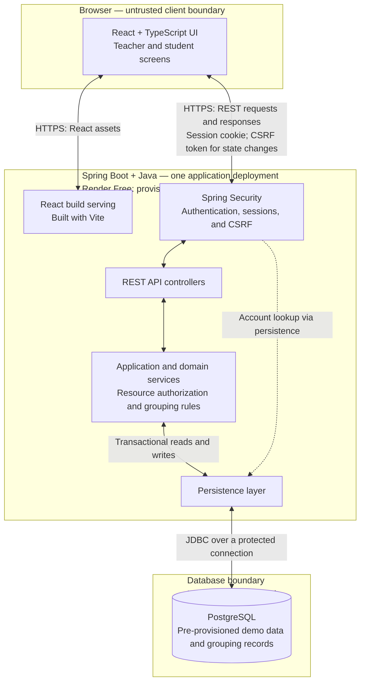

# V1 System Architecture

**Product scope status:** V1 scope and supporting documents confirmed by the user on 2026-10-12; product grilling is complete. Technical design and Project Foundation validation below remain pending. No technical choice, project initialization, implementation, or deployment is authorized by this closure.

**Confirmed review decisions Q54–Q60:** Creation requires a deadline strictly in the future according to backend time; missing or nonfuture deadlines are rejected with correction feedback. Every student grouping mutation must pass its final backend eligibility check immediately before saving strictly before the current deadline, even if submitted earlier; there is no grace period. New applications and invitations to full groups are rejected. When a join fills the last place, preserve the accepted joining request and apply Q9 to the joining student's other pending requests; automatically system-cancel other students' still-pending applications and invitations targeting that group with the reason "Group full", leaving their requests to other groups and all completed outcomes unchanged. Capacity, pending-request state, membership uniqueness, and the cutoff must remain consistent under concurrent operations; the synchronization mechanism remains to be designed.

Applications are readable only by their applicant and the target group's manager; invitations only by their sending manager and recipient. Other members, classmates, and teachers cannot read those requests, including through direct access. Before the deadline, activity participants may inspect any group's current members and manager identity using the permitted profile fields; after the deadline Q53 restricts final membership information to a student's own group while course peer profiles remain readable. V1 provides no activity deletion, replacement, or reset. Users check existing application, invitation, and result screens by revisiting or refreshing; V1 has no email, push notifications, or separate notification center. Existing status views and action confirmations remain required.

**Q61 — Instructions remain editable after deadline:** The assigned teacher may edit the activity's task description and guidance after the grouping deadline, including during allocation and after roster finalization, subject to authentication, course assignment, resource authorization, and CSRF checks. The edit changes instruction text only; it cannot change capacities, participants, memberships, request outcomes, the allocation plan, the deadline, or CSV data, and does not reopen grouping. Confirmed saving shows the current saved text; rejected or definitively failed saves leave it unchanged. Q60's notification policy still applies; Q63 excludes user-facing description history and restore.

**Confirmed review decisions Q62–Q70**

**Q62 — Required plain-text description:** Activity instructions are required plain text, limited to 5,000 characters. Blank/whitespace-only or oversized descriptions are rejected with correction feedback at creation and on every subsequent edit; an invalid edit preserves the saved text. V1 introduces no rich-text editor, attachments, or additional activity fields.

**Q63 — Current description only:** Users see only the latest saved activity description. V1 provides no user-facing description version history or restore feature; this does not remove the separate request history confirmed under Q67.

**Q64 — Declared deadline timezone:** All deadline entry and display use Asia/Taipei time, clearly labeled, regardless of the user's device timezone. Backend time remains authoritative and Q54/Q55 eligibility rules still apply.

**Q65 — No earlier request expiry:** Pending applications and invitations have no separate expiration timer before the activity's current deadline. They end through a permitted response, Q9 join-triggered cancellation, Q56 group-full cancellation, or Q40 deadline expiry; an unanswered request may remain pending until one of these outcomes.

**Q66 — No aggregate pending-request cap:** V1 adds no overall numeric limit to a student's pending applications or received invitations across groups. Q11/Q16 still enforce one pending application and one pending invitation per student/group pair; eligibility, full-group checks, and the deadline remain mandatory.

**Q67 — Completed request history:** The two authorized parties may read every completed application or invitation attempt, with its outcome and cancellation reason, alongside subsequent attempts and after the deadline/finalization. Applications remain private to applicant and target manager; invitations remain private to sending manager and recipient. Preserve each completed attempt rather than replacing its visible outcome with a new pending attempt. History does not expose another student's final group or another group's final member list; it does not permit responding to a completed request or acting after the cutoff.

**Q68 — Empty-group joining conflict:** If another student joins the empty group first, the losing request establishes no membership or manager status and triggers no join cleanup. Show "This group is no longer empty" with refreshed permitted group information; the student deliberately chooses whether to apply if still eligible, the group has capacity, and the deadline is still open. No application is automatically submitted.

**Q69 — Unavailable final results:** After the deadline and before successful complete finalization, existing result screens explain that results are being finalized or temporarily unavailable, with a refresh option. Do not expose a partial roster or teacher grouping-progress counts. Refresh checks permitted status only; it does not restart allocation, choose a new plan, or resubmit a grouping mutation. Q44's preserved-plan recovery rules remain unchanged; there are no new teacher assignment or allocation controls.

**Q70 — Seeded username/password login, no recovery UI:** Teachers and students log in with a provided username and password. Credentials are supplied through demo setup; V1 provides no self-service Forgot password workflow. Forgotten credentials require help outside the app, without introducing a registration or administrator workflow. Existing password hashing, authenticated sessions, authorization, and logout requirements remain in force.

**Q71 — Applications require an occupied group and manager:** An ungrouped participant may apply only to an occupied group with a manager and available capacity before the current deadline. Applications to empty groups are rejected without recording a pending request; empty groups use deliberate first joining under Q28, which establishes the initial manager. Reapplications use the same checks.

**Q72 — Minimum participants and nonempty capacity list:** Activity creation requires at least two eligible participants and a nonempty manually entered capacity list. Reject courses with zero or one participant and empty capacity lists with an explanation, leaving the course without a grouping activity. Each capacity must still be a whole number of at least 2, and the total must exactly equal the fixed all-enrolled participant count.

## Purpose and scope

This document records the approved modular monolith architecture for the Classroom Grouping System. It is based on [the product definition](product-definition.md) and the confirmed technology selections.

V1 supports teacher and student workflows for managing grouping activities, discovering classmates and groups, forming teams, and obtaining final grouping results. Detailed business rules remain subject to the PRD.

Teacher accounts, student accounts, courses, teacher-course assignments, and student-course enrollments are pre-provisioned in PostgreSQL using appropriate demo seed data. After login, teachers see only their assigned courses, select a course needing a grouping activity, and create and configure that activity. Not every course needs a grouping activity. Teachers do not create courses in the UI; self-registration and course enrollment management are outside V1 scope.

Teachers configure sizes, deadlines, and instructions and view, obtain, and export the final grouping roster. Students manage team formation themselves. Teachers cannot monitor live grouping progress, manually assign students, or review or approve student join applications. The system handles remaining ungrouped students under the confirmed PRD rules.

The application consists of one Spring Boot deployment and one PostgreSQL database. Internal modules are logical code boundaries, not independently deployed services. AI features and AI infrastructure are outside V1 scope.

The confirmed V1 course/activity relationship permits zero or one grouping activity per course. The backend must preserve this limit, including concurrent creation requests. Deletion, replacement, and reset are excluded under Q59; this relationship does not select a schema or concurrency mechanism.

The teacher manually enters the capacity layout, such as 2, 2, 2, 3 for the confirmed nine-student example. The system prepares one group per entry with that capacity, which is its joining limit. A normal target size describes intention and is not the layout-generation input; no automatic group-count or remainder formula is selected. Creation requires at least two eligible participants and a nonempty capacity list under Q72; rejection leaves no activity/groups. The backend must reject lists whose total differs from the eligible student count and return correction feedback, without silently adjusting the list. Each capacity must also be a whole number of at least 2; invalid entries are rejected even when the total matches. The capacity layout is immutable after successful creation in V1, including before anyone joins. Backend checks reject capacity changes or additions/removals/replacements that alter the layout; no mutation of groups, memberships, or pending requests results. No additional capacity limit is selected; creation-time consistency enforcement remains technical design work. Activity creation saves the activity and all capacity-list groups together in one database transaction, with no separate generation step. A definitive transaction failure persists neither; a lost response requires checking committed state. Successful creation immediately makes the activity visible to eligible students and opens permitted grouping actions under Q33. V1 has no separate publish step, saved draft lifecycle, or scheduled opening; current resource and membership/capacity checks still apply. Assigned teachers may edit the activity's task description while grouping is open under Q35 and after the deadline/finalization under Q61. The backend checks authentication, course assignment, resource access, and CSRF before saving instruction text; the edit changes no capacities, groups, memberships, requests, or deadline. Assigned teachers may also extend the deadline while grouping remains open under Q36; the new deadline must be later than the currently stored deadline. The backend rechecks permissions, CSRF, current open status, and current deadline before updating only the deadline. Q37 excludes deadline shortening; earlier-deadline requests are rejected without changing the deadline or other activity/group/request state. Q38 excludes extending the deadline or reopening once the current deadline has passed; rejected requests leave deadline, activity/group state, memberships, and request outcomes unchanged. Q54 requires a future initial deadline and Q55 fixes eligibility timing at the final backend check before saving. Concurrency implementation remains unresolved. Q64 fixes deadline entry/display to labeled Asia/Taipei; Q63 excludes description history/restore. Q59 excludes activity deletion/replacement/reset; Q60 excludes email, push, and a separate notification center. Exact total capacity alone does not guarantee completed grouping or finalization. System assignment respects prepared capacities; no extra-group creation or overflow is assumed. Q43 selects shuffled remaining-student ordering; randomness, plan retention, and capacity-enforcement implementation remain technical design work.

Within a grouping activity, a student may belong to at most one group at a time. All membership-establishing operations, including system assignment, must preserve this rule under concurrency. Pending applications and invitations do not establish membership. Only ungrouped students may join empty groups, submit applications, or receive new invitations; joining cancels other pending requests. Voluntary leaving and self-service switching are excluded from V1; activity reset is excluded under Q59; eligibility and lifecycle follow the confirmed rules. No database schema or concurrency mechanism is selected.

Q51 adds an optional course-specific About me to peer profiles beside Student name and institutional Student ID. Students edit only their own course introduction; accept plain text from 0 to 500 characters and reject longer values with correction feedback. The backend checks authentication, course/resource access, ownership, CSRF, and applicable edit availability, and treats the introduction as text rather than executable markup. Saving changes only that student's course introduction, without changing grouping state, participant lists, capacities, request outcomes, allocation plans, seeded names/IDs, or CSV columns. Q52 permits this editor after the grouping deadline and finalization, with the same ownership, authentication, course/resource, CSRF, and length checks. Do not apply the student grouping-mutation cutoff to this profile-only edit; finalized memberships, requests, allocation plans, and CSV remain unchanged. Q53 keeps same-course name/Student ID/current About me readable after the deadline and finalization. Enforce own-group-only final membership access: profile/group requests must not reveal another student's final group or another group's final membership list; the teacher's full roster remains inaccessible to students. Reading permissions follow Q51/Q53/Q57/Q58/Q67; no additional service or AI is introduced.

Q47 assigns fixed activity-local group names at creation in capacity-list order: Group 1, Group 2, and so on. The same labels appear in discovery, requests, results, and roster exports. Neither teachers nor students can supply custom names or rename groups in V1; reject direct naming changes without altering state. This does not select database identifier design or require names to be globally unique across activities.

Q41 fixes the activity's eligible participant list and count at successful creation. Capacity-total validation, grouping eligibility, and remaining-student assignment use that same list. Establish the list with the activity and groups transactionally; failed creation must leave no partial activity-specific participant list. Later enrollment changes do not automatically add/remove activity participants, and V1 has no post-creation participant-list editing. Q42 automatically includes all students enrolled in the course at activity creation, regardless of login or prior grouping actions; no teacher subset-selection or individual exclusion is allowed. Creation-time consistency enforcement remains technical design work; no participant-table/schema design, enrollment-management workflow, or reset bypass is selected.

Q40 requires the deadline to expire all still-pending activity applications/invitations, then automatically assign every remaining eligible ungrouped student to empty places in the existing groups, preserving established memberships and capacities. Expired outcomes remain expired through system assignment; Q9 affects only requests still pending. Completed request outcomes and other activities remain unchanged. After successful complete assignment, the system finalizes the roster and makes it available for assigned-teacher viewing/export, without a manual assignment/finalization step. Incomplete or failed processing cannot be exposed as a final roster; no push notification or instantaneous processing promise is implied. Q41 fixes the participant set at activity creation; Q43 confirms shuffled remaining-student order into existing empty places, without using application/invitation history. Creation-time consistency, slot enumeration, randomness implementation and plan-retention design, cutoff races, transaction scope, execution mechanism, and recovery/retries remain technical design work. Member identities use the confirmed Q51 profile fields; additional fields have not been selected.

Q44 requires retaining a single chosen student-to-group allocation plan before applying assignments and reusing it through failures, restarts, lost responses, retries, and duplicate/concurrent processing. Reconcile actual committed memberships and apply only missing planned placements; never reshuffle, move saved members, or create duplicate memberships. A retry after successful completion preserves the completed roster. Plan persistence/schema or seed design, transaction scope, retry triggering/backoff, and recovery for inconsistent data remain unresolved; no worker or retry service is selected.

Q39 requires backend enforcement of the current activity deadline for every student grouping mutation, including request rejection as well as acceptance, submission, sending, and empty-group joining. Stale UI and direct requests cannot bypass the cutoff; late actions cannot change memberships or requests. A permitted deadline extension updates the cutoff. Q40 confirms deadline expiry, allocation, and finalization. Q55 fixes in-flight request eligibility; concurrency implementation and execution/recovery details remain unresolved; Q57–Q58 fix request and pre-deadline membership reading. Q53 permits post-deadline peer profiles, with final membership details restricted to the student's own group.

The system creates all predetermined-capacity groups together with their activity under Q32; students cannot create groups. The first ungrouped student deliberately joining an empty group becomes its initial manager and member. Membership, sole initial manager identity, and request cleanup are recorded together transactionally. Current occupancy, eligibility, and membership uniqueness must be protected under concurrency: stale empty-group requests cannot directly join an occupied group or establish a second manager. A failed transaction leaves the pre-created group intact. Occupied-group applications need manager approval, while invitations retain their recipient acceptance route. Q46 leaves groups first populated by post-deadline system assignment without a manager and preserves existing managers; manager absence does not block allocation, finalization, or member result access. No additional management rights have been selected; no broader team-leader role is defined.

Join applications require approval from the target group's manager; only that manager may approve or reject them. Under Q71, submission requires an occupied group with a manager and available capacity; empty groups use deliberate joining, and applications to empty groups are rejected without recording a request. Permitted submission records a pending application without establishing membership or reserving capacity. Other permitted joins may use the capacity before approval. The backend checks manager identity and current resource access and rechecks joining eligibility, membership uniqueness, and capacity before recording accepted membership and application outcome together. Other members cannot decide or read applications under Q57. Teachers cannot review or approve applications. Application eligibility and lifecycle are confirmed; activity reset is excluded under Q59; transfer of review authority is excluded from V1.

Only the target group's manager may send invitations for that group, and only to classmates without membership in the activity. The backend verifies manager identity, current resource access, and recipient membership status when recording an invitation, including concurrent invitation sending and joining. Other members and teachers cannot send one; already-grouped classmates cannot receive a new one. Pending invitations reserve no places; acceptance rechecks current eligibility and capacity. Joining through another route cancels pending invitations under the cleanup rule. Q71 and the confirmed request lifecycle govern eligibility; activity reset is excluded under Q59; transfer of invitation authority is excluded from V1.

All membership-establishing operations also automatically cancel the student's other pending join applications and received invitations within that activity, recording membership and cleanup together transactionally. The request establishing membership remains accepted. Cleanup excludes other activities, prior completed outcomes, and invitations sent to other students; concurrent responses cannot use canceled requests to establish membership. This behavior does not introduce a worker, notification channel, or manual cancellation workflow.

The backend preserves at most one pending invitation per group and recipient, including repeated or concurrent sends. The manager may invite the same student again after rejection when current eligibility permits; prior rejection alone does not prohibit another invitation. Ungrouped students may have invitations pending from different groups concurrently, without reservations; an invitation from one group alone does not prevent another group's invitation. Membership uniqueness and transactional cleanup apply under concurrent responses. These rules do not select a schema, concurrency mechanism, or persistence design. Q66 excludes aggregate pending-request caps; Q67 requires completed-attempt history, and current eligibility governs every new send.

A pending application and invitation may coexist for the same ungrouped student and group, with one pending request of each type. Creating either does not automatically accept or close the other, and the existence of one alone does not block creation of the other. Existing actor permissions and eligibility checks apply independently. Rejecting either changes only that request, leaving a pending counterpart eligible for its normal response under current checks. Joining through either route accepts the used request and cancels still-pending requests transactionally under the cleanup rule, preserving completed rejections.

Only ungrouped students may submit applications or reapplications in an activity; the backend checks current membership before recording a pending application, including concurrent submissions and joining. Submission cannot remove or switch existing membership. Ungrouped students may apply to different groups concurrently without reserving places, and joining triggers cleanup. The backend preserves at most one pending application per student and target group; no particular schema or concurrency mechanism is selected. Reapplication after rejection is allowed subject to current eligibility; prior rejection alone does not block it. Q66 excludes aggregate pending-request caps; Q67 requires completed-attempt history. Every new attempt needs current eligibility; persistence design remains technical.

Student manual withdrawal of pending applications and manager manual cancellation of pending invitations are outside V1. No such UI actions are provided, and direct requests cannot withdraw applications or cancel invitations. Students wait for recorded outcomes; recipient responses and automatic cancellation when joining still apply subject to current checks. Q39 stops all student grouping actions at the current activity deadline; Q40 expires still-pending requests at the deadline; Q65 excludes earlier expiration.

Voluntary group departure by ordinary members and managers is temporarily outside V1, including a self-service switch that leaves existing membership. The UI offers no departure action, and direct requests cannot remove membership through voluntary departure. This applies regardless of whether membership arose from empty-group joining, application approval, invitation acceptance, or system assignment. Departure is prioritized for V2; its detailed rules and implementation are not selected. Manager member removal is excluded under Q24; activity reset is excluded under Q59. No other removal capability is confirmed.

Group managers cannot remove existing members in V1, regardless of how membership was established. No removal UI is provided, and direct requests cannot remove membership or free a place. Rejecting a pending application is a request outcome, not permission to remove a member. Activity reset is excluded under Q59 and manager status does not authorize it; authority transfer is excluded under Q25. The prioritized V2 departure feature does not separately select a member-removal feature.

The original group manager retains sole application-decision and invitation authority in V1; transfer or delegation is excluded. Neither UI actions nor direct requests can assign these permissions to another member. Ordinary members use permitted student discovery and recommend candidates to the manager outside the application, in person or through existing channels. No in-app candidate-suggestion workflow or messaging integration is introduced, and a recommendation changes no application, invitation, or membership state.

## System Architecture Diagram

Both browser-facing connections use the same HTTPS origin. The security component represents a logical responsibility within Spring Boot, not a separate service. Session storage is intentionally unspecified in this diagram; server-side sessions do not imply in-memory storage.

The diagram shows system communication and boundaries. It is not a User Flow Diagram, database schema, or exact mapping of Java classes.

## Component responsibilities

| Component | Responsibilities |
|---|---|
| React + Vite + TypeScript | Present teacher assigned-course selection, activity configuration, and final-roster screens, and student discovery/team-formation screens. Collect input and call the REST API. There is no teacher course-creation, self-registration, or enrollment-management UI. Teacher screens do not expose live grouping progress or assignment/application-review controls. Vite produces the frontend build; it is not a separate production application server. |
| Spring Boot build serving | Serve compiled React assets and support direct navigation to frontend routes under the same origin as the API. |
| Spring Security | Authenticate pre-provisioned local accounts, manage authenticated sessions and logout, apply request-level access rules, and preserve CSRF protection for state-changing requests. |
| REST API controllers | Receive requests, validate request structure, invoke application services, and return appropriate responses or errors. |
| Application and domain services | Enforce resource-level permissions and confirmed teacher restrictions, coordinate student-managed team formation and system assignment, and define transaction boundaries. |
| Persistence layer | Read and write application records through the backend database connection. The persistence library and exact schema remain undecided. |
| PostgreSQL | Store pre-provisioned accounts, courses, teacher-course assignments, student-course enrollments, and durable grouping data; enforce relational integrity through constraints and transactions. Demo seeding is a setup responsibility, not an additional deployed service. |
| Server-side session storage | Retain authenticated session state. Its implementation remains open; this responsibility does not introduce an additional infrastructure service. |

Application and domain services are organized around these functional responsibilities:

- **Course and activity management:** Retrieve only the teacher's assigned existing courses and support activity creation and configuration of the manual capacity list, instructions, and deadlines for a selected assigned course. Courses and enrollment records come from demo seed data; not every course requires an activity. This module does not introduce course creation or enrollment management in the UI.
- **Student discovery and team formation:** Student access to permitted classmate name, institutional Student ID, course-specific About me, and group availability; own-course introduction editing, and student management of memberships, applications, invitations, and their outcomes. Teachers do not review or approve join applications.
- **Grouping results:** Student group views and teacher viewing, obtaining, and exporting of the final grouping roster. Identification of remaining ungrouped students supports system assignment, not teacher progress monitoring.

Support for assigning remaining students belongs within grouping logic and is performed by the system, not through manual teacher assignment. Q40 confirms automatic completion after the activity's current deadline; Q43 confirms random student ordering into existing empty places, ignoring earlier applications and invitations; randomness implementation and plan-retention design and execution/recovery details remain open. This architecture selects no scheduler or background worker and grants no teacher assignment or finalization controls.

## Communication and data flows

### Application loading

The browser requests the application over HTTPS. Spring Boot serves the React build. React then requests data from the REST API under the same origin.

### Authentication and sessions

The browser submits the demo-provided username and password to the backend (Q70). Spring Security uses account information and stored password hashes to authenticate the user. Successful authentication establishes a server-side session and returns a Secure, HttpOnly session cookie.

The browser holds a session identifier; authenticated session state remains server-side. Subsequent API requests carry the cookie automatically. State-changing requests must also satisfy CSRF protection. Logout invalidates the authenticated session.

Accounts and teacher/student roles are pre-provisioned through demo seed data, as are course assignments and enrollments. Self-registration and enrollment management are outside V1 scope. Q70 excludes self-service password recovery; credentials are supplied with demo setup.

### Selecting an assigned course

After teacher login, React requests the course list. The backend identifies the teacher and returns only courses assigned to that teacher in PostgreSQL. The teacher selects a course needing a grouping activity. The backend checks that assignment again when accessing the selected course or creating/configuring its activity; a filtered list is not an authorization boundary. This selection does not require every course to have a grouping activity.

### Reading grouping information

React requests information permitted for the requester. Student course access is checked against pre-provisioned enrollment records; activity, profile, group, and membership reading follows Q51/Q53/Q57/Q58/Q67. Teacher access covers assigned-course selection, activity configuration, and the final grouping roster, not live grouping progress.

The backend identifies the requester and verifies access to the particular resource before retrieving permitted data from PostgreSQL. Detailed student visibility remains subject to the PRD; Q40 confirms teacher roster availability after successful complete deadline processing; the confirmed teacher restrictions are not open decisions.

### Changing grouping data

For student operations such as deliberately joining an empty group, applying to join, or accepting an invitation, the backend validates authentication, CSRF, permissions, and domain rules before performing the required writes. Teachers cannot review or approve join applications or manually assign memberships. Remaining-student assignment is a system operation governed by the confirmed PRD rules; execution and recovery mechanisms remain technical design work.

Related changes are coordinated within a database transaction. The response communicates the outcome, and React updates or reloads the relevant information. Concurrency handling must protect the final membership and capacity rules established by the PRD.

### Obtaining grouping results

The backend verifies access and retrieves the appropriate student or teacher result view. Teachers can view, obtain, and export the final grouping roster. The backend checks final-roster availability before exposing roster data to a teacher; it does not provide live progress views. Q40 makes teacher access available only after the deadline and successful complete assignment/system finalization. Q45 grants each activity participant their own final group/member view at the same successful system-finalization point as assigned-teacher access, including system-assigned participants. Enforce participant/resource access and deny student requests for the teacher's full roster. Q48 specifies an assigned-teacher CSV download from the finalized result, subject to the same backend authorization and availability checks. Q49 fixes exactly one row per participant and Group name, institutional Student ID, Student name columns, covering both self-grouped and system-assigned members without omissions or duplicates. Q50 orders CSV rows by ascending numeric group number, then institutional Student ID within each group, consistently for the same finalized data. CSV encoding/dialect, filename/output consistency and processing/recovery implementation remain technical design work; member fields follow Q51; no teacher finalization control or file-storage service is implied.

### Database communication

Only the backend connects to PostgreSQL. Database credentials stay on the backend and are not included in the React build. JDBC communication uses a protected database connection; detailed connection and pool settings will be established during Project Foundation.

## Security and transaction boundaries

| Boundary | Architectural rule |
|---|---|
| Browser to backend | Treat browser input as untrusted. Frontend validation and hidden controls do not enforce security. |
| Authentication and session | Spring Security establishes identity and validates the server-side session. Use Secure, HttpOnly session cookies. |
| CSRF | Preserve CSRF protection for state-changing browser requests. Sharing an origin does not remove this requirement. |
| Authorization | Enforce role-based access and resource-level permissions on the backend, including teacher-course assignments and student-course enrollments from pre-provisioned data. Recheck the relevant relationship on resource requests, not just course-list retrieval. Deny teacher live-progress access, manual student assignment, and join-application review/approval. Hiding frontend controls is insufficient. A role alone does not establish access to every course, activity, or group. |
| Domain and transaction | Application services coordinate business operations and transactions. Use database constraints and an explicit concurrency strategy to protect integrity. Transactions alone do not automatically enforce group capacity. |
| Database | PostgreSQL stores durable data. Browsers cannot access it directly or receive database credentials. |
| Deployment | React assets and the REST API share one HTTPS origin. Hosting providers are replaceable without unnecessarily changing the application architecture. |

Cookie policies and any development-time CORS configuration must be deliberate. The deployed same-origin topology simplifies browser integration but does not replace secure cookie handling or authorization.

If sessions are held in memory, application stops, restarts, and redeploys invalidate them. Persistent sessions could improve continuity, but their storage and operational implications remain an open decision. Durable application data belongs in PostgreSQL, not the hosting application's temporary filesystem.

## Decision status

### Confirmed

| Area | Decision |
|---|---|
| Architecture | Modular monolith for V1. |
| Frontend | React + Vite + TypeScript. |
| Backend | Spring Boot + Java. |
| Database | PostgreSQL. |
| Authentication | Spring Security with local accounts and server-side sessions. |
| Browser security | Secure, HttpOnly session cookies; CSRF protection; deliberate cookie and CORS policies. |
| Authorization | Backend role-based and resource-level checks. |
| Demo data and account model | Pre-provision teacher/student accounts, courses, teacher-course assignments, and student-course enrollments using seed data. No self-registration or enrollment management in V1. |
| Course selection | Show teachers only assigned existing courses; not every course needs a grouping activity. No teacher course-creation UI. |
| Course/activity cardinality | Each course may have zero or one grouping activity in V1. Multiple activities for the same course are outside V1 scope. |
| Group-size meaning and capacity | Teacher-entered capacities determine the prepared groups: one group per list entry, each with its own joining limit. The approved example is 2, 2, 2, 3 for nine students. Every capacity is a whole number of at least 2, and the list must sum exactly to the eligible student count. No automatic layout calculation from a target is selected. The activity and all groups are saved together transactionally at activity creation. Eligible-student visibility and permitted grouping open immediately after creation, with no separate publish step or scheduled opening. Capacities and the layout are fixed after creation. No additional capacity limit or profile field is selected. Creation-time consistency and deadline synchronization remain technical design work; confirmed reading permissions apply. Q63 excludes description history/restore; Q64 fixes deadline entry/display to labeled Asia/Taipei. Q54–Q55 fix initial deadline validation and backend eligibility timing; Q59–Q60 fix lifecycle exclusions and notification scope. Extension/reopening after expiry is excluded under Q38. |
| Activity instructions | Assigned teachers may edit task-description/guidance text while grouping is open and after the deadline/finalization; backend permission checks apply and the grouping cutoff does not block this text-only edit. Edits affect neither the fixed capacity layout nor memberships, requests, or deadline. Q61 also permits text-only edits after the deadline and finalization; Q63 excludes user-facing description history/restore and Q60 resolves notifications. |
| Deadline extension and shortening | Assigned teachers may extend a deadline to a later time while grouping remains open; backend checks current permission, open status, and stored deadline. Only the deadline changes. Shortening is excluded under Q37 and extension/reopening after the current deadline passes is excluded under Q38. Q55 fixes the backend-time cutoff; concurrency implementation remains technical design work; no deadline-history feature has been selected; Q60 resolves notifications. |
| Teacher permissions | Create and configure activities for assigned courses; configure sizes, deadlines, and instructions; view, obtain, and export the final roster. No live-progress monitoring, manual student assignment, or join-application review/approval. |
| Team formation | Students form groups before the current deadline. Q40 expires pending requests, assigns all remaining eligible students into existing empty places, and finalizes the complete teacher roster. Q43 uses shuffled remaining-student ordering, ignoring past request outcomes. Randomness implementation and plan-retention design and execution/recovery details remain open. |
| Final-result access | At successful complete system finalization, assigned teachers gain full-roster access and participants gain only their own final-group/member view simultaneously under Q45. Students cannot access the teacher's full roster. Member identities use the confirmed Q51 profile fields; no push delivery or student export right is granted. |
| Final-roster export | Assigned teachers may download the finalized roster as CSV under Q48, with backend course authorization and finalization checks. Q49 fixes one row per participant and the three Group name/Student ID/Student name columns; Student ID is the institutional number. Q50 sorts by numeric group number then Student ID ascending; remaining format details are unresolved; no student export, push delivery, or file-storage service is granted. |
| Membership uniqueness | At most one group membership per student per activity at a time, including under concurrent operations. Voluntary leaving and self-service switching are excluded from V1; activity reset is excluded under Q59; eligibility and lifecycle follow the confirmed rules. |
| Course peer profiles | Name, institutional Student ID, and optional course-specific About me under Q51. Each student edits only their own plain-text introduction; empty text is valid and the maximum is 500 characters. Q52 permits own introduction editing after the grouping deadline and finalization, preserving grouping state and CSV. Q53 permits profile discovery after the deadline while final membership details are restricted to the student's own group. Q51/Q53/Q57/Q58/Q67 specify fields and reading permissions. |
| Group names | Fixed Group 1, Group 2… labels follow the teacher's capacity-list order within each activity under Q47; all flows use the same names. No teacher/student custom naming or renaming in V1. |
| Empty-group joining and initial manager | Groups are system-created with predetermined capacities. Only ungrouped students may deliberately join an empty group; membership, sole initial manager identity, and cleanup are recorded together transactionally. Stale requests cannot bypass occupied-group approval. Groups first populated by post-deadline system assignment have no manager under Q46; existing managers remain unchanged. |
| Join applications | Only occupied groups with a manager and available capacity may receive an application under Q71. Only the target group's manager may approve or reject applications; submission does not establish membership or reserve places. Current capacity is checked when joining. Application eligibility and lifecycle are confirmed; activity reset is excluded under Q59; authority transfer is excluded from V1. |
| Invitations | Only the target group's manager may send invitations, only to ungrouped classmates in the activity. Pending invitations do not reserve places; current eligibility and capacity are checked when joining. Invitation eligibility and lifecycle are confirmed; activity reset is excluded under Q59; authority transfer is excluded from V1. |
| Invitation uniqueness and reinvitation | At most one pending invitation per group and recipient, including concurrent sends. Reinvitation after rejection and concurrent invitations from different groups are allowed. Q66 excludes aggregate pending-request caps; Q67 preserves completed attempt history, with current eligibility still required. |
| Application/invitation coexistence | One pending application and one pending invitation may coexist for the same student and group. Creation does not accept or close the counterpart; rejection affects only the answered request. Successful joining cancels still-pending requests under the cleanup rule. |
| Pending-request cleanup | Establishing membership automatically cancels the student's other pending applications and received invitations in that activity, transactionally with membership. Other activities and outgoing invitations are unaffected by this cleanup. |
| Pending applications | Only ungrouped students may apply, including to different groups concurrently, with at most one pending application per target group. Reapplication after rejection is allowed; Q66 excludes aggregate pending-request caps; Q67 preserves completed attempt history, with current eligibility still required. |
| Applicant withdrawal | Students cannot manually withdraw pending applications in V1. Waiting for an outcome does not disable automatic cancellation upon joining. |
| Manager invitation cancellation | Managers cannot manually cancel pending invitations in V1. Recipient responses and automatic cancellation upon joining remain applicable under current rules. |
| Voluntary group departure | Excluded temporarily from V1 for members and managers; self-service switching cannot bypass the restriction. Prioritized for V2, with detailed rules undecided. Manager member removal is excluded under Q24; activity reset is excluded under Q59. |
| Manager member removal | Managers cannot remove existing members in V1. Application rejection affects only the request, not an established membership. Activity reset is excluded under Q59; authority transfer is excluded under Q25. |
| Initial group manager authority | The initial group manager alone decides applications and sends invitations; transfer and delegation are excluded from V1. |
| System-only group manager | Groups remaining empty until post-deadline system assignment have no manager under Q46. Do not appoint the first allocated member. Existing managers in other groups are preserved; manager absence does not prevent finalization or result access. |
| Candidate recommendations | Members discover permitted candidates and tell the manager through existing external communication. In-app suggestions and messaging integration are outside V1. |
| Deployment topology | Spring Boot serves the React build and REST API under one HTTPS origin. |
| V1 scope | Non-AI classroom grouping functionality; no AI services. |
| Hosting validation | An early deployment smoke test during Project Foundation, before substantial feature development. |

### Provisional

**Render Free + Neon Free** is the proposed initial hosting solution. It has not been validated for the application. The initial deployment proposal uses one Spring Boot instance.

The Project Foundation smoke test must verify:

- Application startup and deployment readiness.
- Memory and CPU constraints.
- PostgreSQL connectivity and connection recovery.
- Session, cookie, and CSRF behavior.
- Cold starts and application restarts.
- Basic API responsiveness.

If Render Free is unsuitable, reevaluate the hosting provider while preserving the application architecture where practical. Free-plan suitability for a portfolio demo does not establish suitability for reliable live classroom use.

### Deferred technical design

- In-memory versus persistent session storage.
- Final hosting provider and compute plan after deployment validation.
- Persistence library, relational schema, and migration approach.
- Transaction details and concurrency control for grouping operations.
- JVM, connection-pool, timeout, and concrete cookie settings.
- Backup and recovery arrangements.
- Creation-time consistency, deadline synchronization, slot enumeration, randomness implementation, plan retention, and execution/recovery mechanisms. Product permissions, profile fields, complete finalization, post-deadline text/profile editing, and teacher restrictions are confirmed by the PRD.
- Final-roster CSV encoding/dialect, filename, and output consistency. Q48–Q50 confirm assigned-teacher CSV download, its three columns, and ordering by numeric group number then Student ID.

Potential future AI features and pgvector remain future possibilities. They do not introduce any component or dependency into the V1 architecture.
