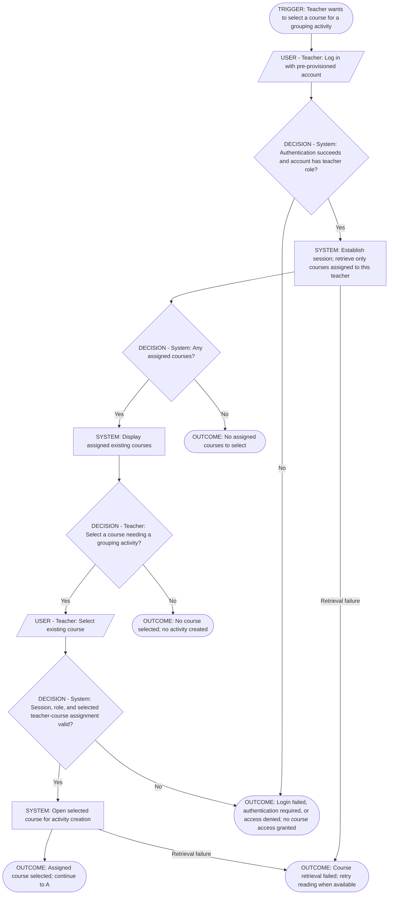
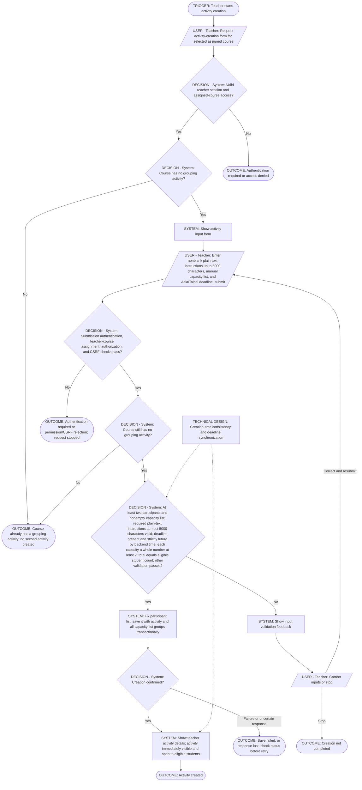
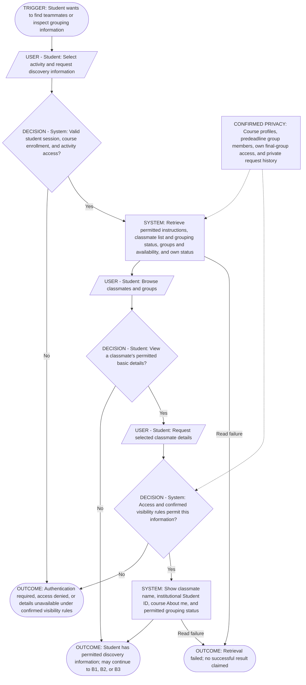
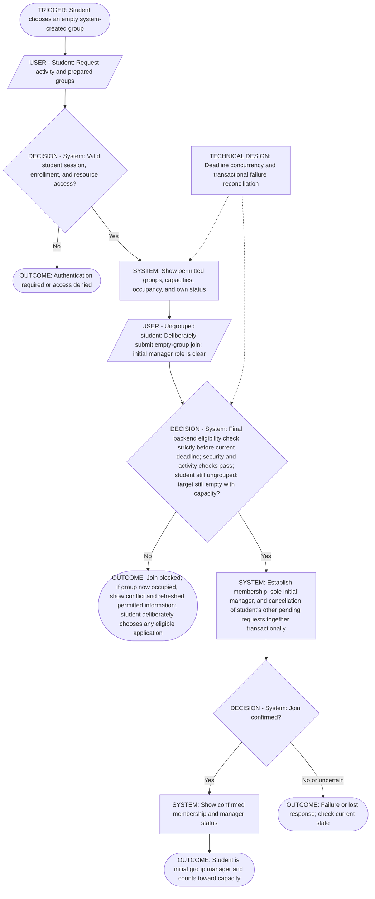
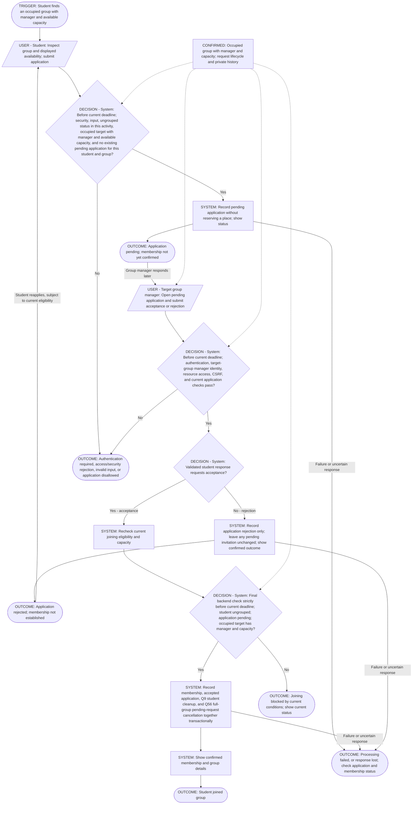
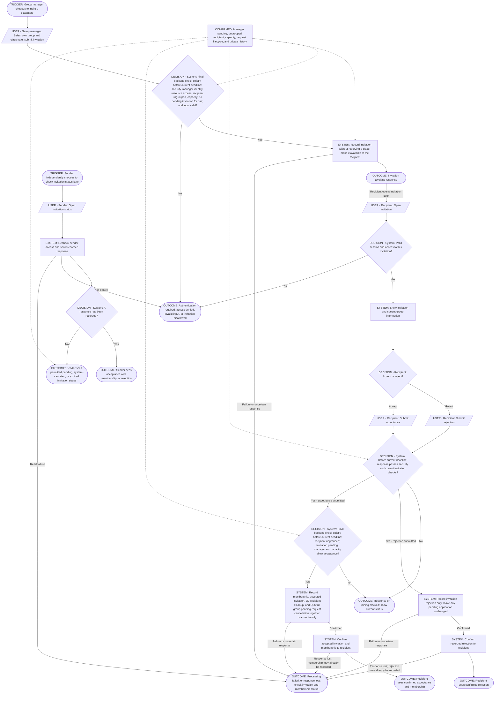
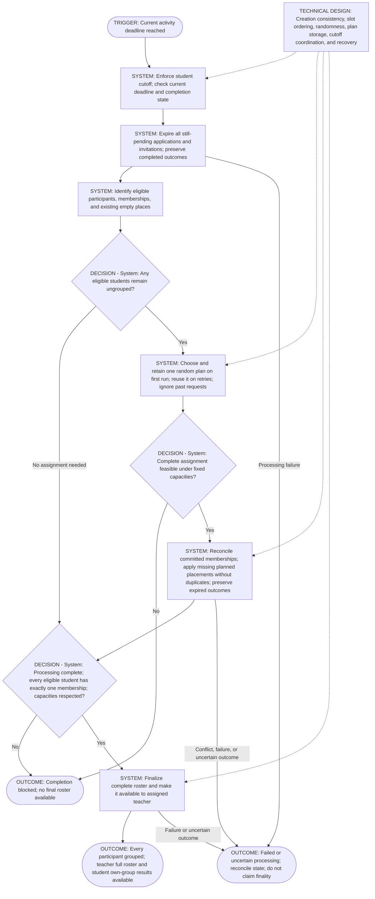
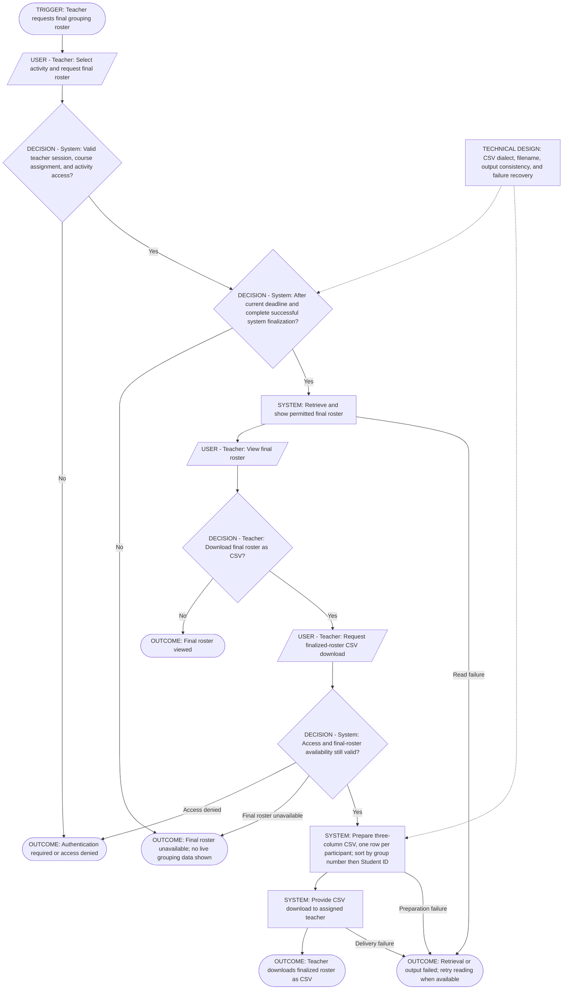
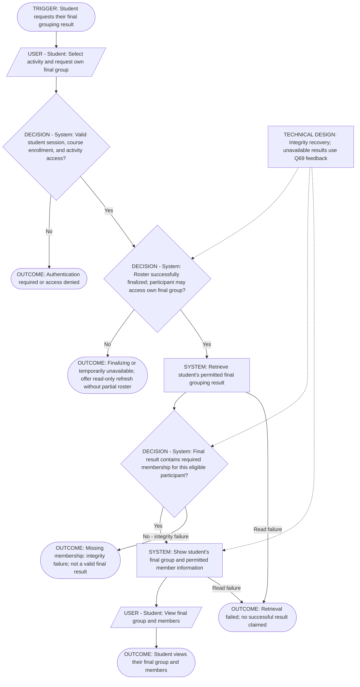

# V1 User Flows

**Product scope status:** V1 scope and these supporting flows confirmed by the user on 2026-10-12; product grilling is complete. Technical design and diagram revalidation remain pending. This closure does not authorize implementation, project initialization, or deployment.

**Confirmed review decisions Q54–Q60:** Creation requires a deadline strictly in the future according to backend time; missing or nonfuture deadlines are rejected with correction feedback. Every student grouping mutation must pass its final backend eligibility check immediately before saving strictly before the current deadline, even if submitted earlier; there is no grace period. New applications and invitations to full groups are rejected. When a join fills the last place, preserve the accepted joining request and apply Q9 to the joining student's other pending requests; automatically system-cancel other students' still-pending applications and invitations targeting that group with the reason "Group full", leaving their requests to other groups and all completed outcomes unchanged. Capacity, pending-request state, membership uniqueness, and the cutoff must remain consistent under concurrent operations; the synchronization mechanism remains to be designed.

Applications are readable only by their applicant and the target group's manager; invitations only by their sending manager and recipient. Other members, classmates, and teachers cannot read those requests, including through direct access. Before the deadline, activity participants may inspect any group's current members and manager identity using the permitted profile fields; after the deadline Q53 restricts final membership information to a student's own group while course peer profiles remain readable. V1 provides no activity deletion, replacement, or reset. Users check existing application, invitation, and result screens by revisiting or refreshing; V1 has no email, push notifications, or separate notification center. Existing status views and action confirmations remain required.

**Q61 — Instructions remain editable after deadline:** The assigned teacher may edit the activity's task description and guidance after the grouping deadline, including during allocation and after roster finalization, subject to authentication, course assignment, resource authorization, and CSRF checks. The edit changes instruction text only; it cannot change capacities, participants, memberships, request outcomes, the allocation plan, the deadline, or CSV data, and does not reopen grouping. Confirmed saving shows the current saved text; rejected or definitively failed saves leave it unchanged. Q60's notification policy still applies; Q63 excludes user-facing description history and restore.

**Confirmed review decisions Q62–Q70**

**Q62 — Required plain-text description:** Activity instructions are required plain text, limited to 5,000 characters. Blank/whitespace-only or oversized descriptions are rejected with correction feedback at creation and on every subsequent edit; an invalid edit preserves the saved text. V1 introduces no rich-text editor, attachments, or additional activity fields.

**Q63 — Current description only:** Users see only the latest saved activity description. V1 provides no user-facing description version history or restore feature; this does not remove the separate request history confirmed under Q67.

**Q64 — Declared deadline timezone:** All deadline entry and display use Asia/Taipei time, clearly labeled, regardless of the user's device timezone. Backend time remains authoritative and Q54/Q55 eligibility rules still apply.

**Q65 — No earlier request expiry:** Pending applications and invitations have no separate expiration timer before the activity's current deadline. They end through a permitted response, Q9 join-triggered cancellation, Q56 group-full cancellation, or Q40 deadline expiry; an unanswered request may remain pending until one of these outcomes.

**Q66 — No aggregate pending-request cap:** V1 adds no overall numeric limit to a student's pending applications or received invitations across groups. Q11/Q16 still enforce one pending application and one pending invitation per student/group pair; eligibility, full-group checks, and the deadline remain mandatory.

**Q67 — Completed request history:** The two authorized parties may read every completed application or invitation attempt, with its outcome and cancellation reason, alongside subsequent attempts and after the deadline/finalization. Applications remain private to applicant and target manager; invitations remain private to sending manager and recipient. Preserve each completed attempt rather than replacing its visible outcome with a new pending attempt. History does not expose another student's final group or another group's final member list; it does not permit responding to a completed request or acting after the cutoff.

**Q68 — Empty-group joining conflict:** If another student joins the empty group first, the losing request establishes no membership or manager status and triggers no join cleanup. Show "This group is no longer empty" with refreshed permitted group information; the student deliberately chooses whether to apply if still eligible, the group has capacity, and the deadline is still open. No application is automatically submitted.

**Q69 — Unavailable final results:** After the deadline and before successful complete finalization, existing result screens explain that results are being finalized or temporarily unavailable, with a refresh option. Do not expose a partial roster or teacher grouping-progress counts. Refresh checks permitted status only; it does not restart allocation, choose a new plan, or resubmit a grouping mutation. Q44's preserved-plan recovery rules remain unchanged; there are no new teacher assignment or allocation controls.

**Q70 — Seeded username/password login, no recovery UI:** Teachers and students log in with a provided username and password. Credentials are supplied through demo setup; V1 provides no self-service Forgot password workflow. Forgotten credentials require help outside the app, without introducing a registration or administrator workflow. Existing password hashing, authenticated sessions, authorization, and logout requirements remain in force.

**Q71 — Applications require an occupied group and manager:** An ungrouped participant may apply only to an occupied group with a manager and available capacity before the current deadline. Applications to empty groups are rejected without recording a pending request; empty groups use deliberate first joining under Q28, which establishes the initial manager. Reapplications use the same checks.

**Q72 — Minimum participants and nonempty capacity list:** Activity creation requires at least two eligible participants and a nonempty manually entered capacity list. Reject courses with zero or one participant and empty capacity lists with an explanation, leaving the course without a grouping activity. Each capacity must still be a whole number of at least 2, and the total must exactly equal the fixed all-enrolled participant count.

## Scope and notation

These nine flows are based on [Product Definition](product-definition.md) and [System Architecture](architecture.md). They retain the six approved flows and include assigned-course selection, student discovery, and student final-results retrieval to cover confirmed V1 capabilities. They describe user interactions and system responses without defining the PRD or changing the architecture. Mermaid source is authoritative; exported PNG diagrams are not used here.

The React interface communicates with the Spring Boot backend under one HTTPS origin. Spring Security manages local-account authentication and server-side sessions. The backend enforces permissions and grouping rules and stores durable data in PostgreSQL. Session persistence remains undecided.

| Diagram notation | Meaning |
|---|---|
| Parallelogram labeled `USER` | An action performed by the named user. |
| Rectangle labeled `SYSTEM` | A system response or operation. |
| Diamond labeled `DECISION` | A check or choice; the label identifies its owner. |
| Rounded node labeled `TRIGGER` or `OUTCOME` | A starting event or a result. |
| Note labeled `TECHNICAL DESIGN` or `CONFIRMED`, connected by a dashed arrow | A deferred implementation concern or reminder of approved rules; it does not introduce a new product decision. |

Decision nodes apply the confirmed product rules, including approval, capacity, cutoff, request lifecycle, and finalization. Dashed technical notes describe implementation work still needed; they do not change the approved behavior.

## Confirmed V1 permission boundaries

- Teacher accounts, student accounts, courses, teacher-course assignments, and student-course enrollments are pre-provisioned using demo seed data. Teachers and students log in with pre-provisioned accounts; self-registration and course enrollment management are outside V1 scope.
- Teachers see only their assigned existing courses, select a course needing a grouping activity, create and configure that activity, and view, obtain, and export the final grouping roster. Not every course needs a grouping activity. Teachers do not create courses in the UI.
- Each course may have at most one grouping activity in V1; a course may have none. Creating a second activity for the same course is rejected, including under concurrent requests.
- Teachers cannot monitor live grouping progress, manually assign students to groups, or review or approve student join applications.
- Students manage team formation. Only the target group's manager may approve or reject join applications. Under Q57, only that manager and the applicant may read the application; other members and teachers cannot read or decide it. Application submission alone does not establish membership.
- Only the target group's manager may send invitations for that group; other members and teachers cannot send them. Eligibility and lifecycle follow the confirmed rules; no additional policy is assumed.
- Invitations may be sent only to ungrouped classmates in that activity. The backend checks current membership when sending; acceptance rechecks current conditions. Joining in the meantime cancels the invitation under the shared cleanup rule.
- A group may have at most one pending invitation for a particular student, including under repeated or concurrent sends. Reinvitation after rejection is allowed subject to current eligibility. Ungrouped students may have invitations pending from different groups simultaneously; an invitation from one group alone does not block another group's invitation. Q66 excludes aggregate pending-request caps; Q67 preserves completed attempt history; current eligibility still applies.
- One pending application and one pending invitation may coexist for the same ungrouped student and group. Recording either does not automatically accept or close the other or establish membership. The existence of one alone does not block recording the other; each retains its actor permissions and eligibility checks. Rejection changes only the answered request, leaving the pending counterpart unchanged and available for its normal response subject to current checks. Successful joining accepts the used request and cancels the still-pending counterpart under the shared cleanup rule, preserving completed rejection outcomes.
- Neither pending invitations nor pending applications reserve group places or reduce available capacity; another permitted join may use the capacity first. Joining requires current eligibility and capacity checks.
- Only ungrouped students may submit applications or reapplications within an activity, including to multiple different groups concurrently. Existing pending applications to other groups alone do not block a new application; other eligibility rules still apply. Each student may have at most one pending application to a given group, including under concurrent submissions. Reapplication after rejection is allowed; Q66 excludes aggregate pending-request caps; Q67 preserves completed attempt history, with current eligibility still required.
- Students cannot manually withdraw pending applications, and managers cannot manually cancel pending invitations in V1. Recipient responses remain available subject to current checks, and automatic cancellation upon joining still applies. Q39 stops student actions at the current deadline; Q40 expires still-pending requests at the deadline; Q65 excludes earlier expiration; voluntary departure is separately excluded under Q23.
- Neither ordinary members nor managers may voluntarily leave their group in V1, including by self-service switching. No departure UI is provided, and direct departure requests cannot change membership. This applies to memberships established through all confirmed joining routes. Departure is deferred temporarily and prioritized for V2; its detailed rules and timing remain undecided. Manager member removal is excluded under Q24; activity reset is excluded under Q59.
- Managers cannot remove existing members in V1, including students who joined through system assignment. No removal UI is provided, and direct removal requests cannot change membership or capacity. Rejecting a pending application affects only that request; it does not remove an existing member or cancel a pending invitation. Activity reset is excluded under Q59 and is not granted by manager status; authority transfer is excluded under Q25.
- The initial group manager remains the sole person who approves or rejects applications and sends invitations in V1. This authority cannot be transferred or delegated to another member, including through direct requests.
- Ordinary members identify candidates through permitted student discovery, then tell the manager in person or through an existing communication channel. V1 provides no in-app suggestion or messaging integration for this coordination. Recommendations do not alter request or membership state; the manager chooses whether to invite, subject to current eligibility.
- Within a grouping activity, each student may belong to at most one group at a time. A student without membership in that activity is ungrouped. Q40 requires every eligible student to be assigned before finalization; incomplete processing is not a valid final roster.
- The system pre-creates groups with predetermined capacities before student participation. The first ungrouped student deliberately joining an empty group becomes its initial manager and member; occupied-group applications require manager approval. Students cannot create groups.
- Only ungrouped students may deliberately join empty groups. Current occupancy must be checked again when joining; a stale empty-group display cannot bypass approval after another student joins. An already-grouped student's membership remains unchanged.
- Q40 triggers automatic system assignment at the current deadline, filling existing empty places for all eligible ungrouped students. Q43 confirms shuffled remaining-student ordering into empty places without using past requests; slot enumeration, randomness implementation and plan-retention design, execution/recovery, and creation-time consistency remain open; teachers gain no assignment controls.
- Q40 makes the complete final roster available to assigned teachers after the deadline and successful complete assignment/system finalization. Processing failures/incomplete state cannot be labeled final; no teacher finalization action or live-progress access is provided.

Each pre-created group's predetermined capacity is its joining limit. The teacher manually enters the capacity list; 2, 2, 2, 3 specifies four system-created groups in the nine-student example. Each capacity must be a whole number of at least 2 and the total must equal the eligible student count exactly; no additional capacity limit is selected; creation-time consistency enforcement remains technical design work; Q46 confirms no manager for system-only groups. No overflow or extra groups are assumed for system assignment.

**Group names (Q47):** The system assigns fixed Group 1, Group 2… names in capacity-list order at creation. For capacities 2, 2, 2, 3, Groups 1–4 have those respective capacities. All student and teacher views/requests use these same names; V1 has no custom naming or renaming by either role. Names are scoped to each activity.

**Fixed participants (Q41):** At successful creation, the activity's eligible participant list and count become fixed. Capacity validation, student grouping eligibility, and final allocation use this same list; later enrollment changes do not automatically alter it. V1 has no post-creation participant editing. Q42 automatically includes every student enrolled in the course at creation, regardless of login/grouping actions; teachers cannot choose a subset or exclude individual students. Creation-time consistency enforcement remains technical design work; authentication/resource/privacy checks still apply.

**Student grouping cutoff (Q39):** All student grouping mutations stop at the current activity deadline: empty-group joining, applications/reapplications, application approval/rejection, invitations/reinvitations, and invitation acceptance/rejection. Backend checks prevent late changes through stale UI or direct requests. A permitted extension updates the cutoff. Q40 confirms expiry, automatic complete assignment, and system finalization for teacher access. Q55 fixes in-flight eligibility; concurrency/recovery implementation remains technical. Q53/Q57/Q58/Q67 govern permitted reads. Q53 permits course peer-profile reading after the deadline while final membership details are restricted to the student's own group.

## Shared conditions and failure handling

The teacher manually configures the **capacity layout**, with one entry per system-created group. Each capacity is that group's joining limit. No automatic calculation from a normal target size or remainder redistribution is selected; lists with a total below or above the eligible student count are rejected with correction feedback and are not silently adjusted. Entries that are not whole numbers of at least 2 are also rejected, even when the total matches. The capacity layout is fixed after successful creation, even before students join; no later changes to capacities or layout entries/groups are permitted in V1. Rejected changes leave groups, memberships, and pending requests unchanged. No additional capacity limit is selected; creation-time consistency remains technical design work; an exact total alone does not establish completed grouping or finalization.

These conditions apply to every human-initiated flow and to each participant's actions in B3:

- A missing or expired session requires authentication with a pre-provisioned account before continuing. Login failure does not authorize the requested action. Self-registration is outside V1 scope; Q70 excludes self-service password recovery; login uses provided usernames/passwords and forgotten credentials require help outside the app.
- The backend checks roles and access to the specific course, activity, group, application, or invitation and enforces the confirmed teacher restrictions above. Teacher course access is checked against seeded teacher-course assignments, and student course access against seeded enrollments. These checks apply to resource requests, not just filtered lists. Initial inclusion is all students enrolled at creation under Q42; per-action eligibility and reading permissions follow the confirmed rules.
- State-changing browser requests must pass CSRF protection. A failed CSRF check stops the request; it is not a reason to bypass protection.
- Displayed group availability is informational. The backend checks current data when processing changes; stale information can produce a conflict.
- Related changes use database transactions. Transaction scope and concurrency handling must be designed after the business rules are established.
- Every operation establishing membership must preserve at most one group per student per activity, including concurrent application acceptances, invitation acceptances, system assignment, and deliberate first joining of an empty system-created group. Pending applications and invitations do not establish membership. Grouped students cannot join empty groups, submit applications, or receive new invitations. Voluntary leaving and self-service switching are excluded from V1; activity reset is excluded under Q59; eligibility and lifecycle follow the confirmed rules.
- Every operation establishing membership also cancels that student's other pending applications and received invitations in the same activity, recorded together transactionally. The request used for joining remains accepted; other pending requests become system-canceled, not person-rejected. Other activities, prior completed outcomes, and invitations sent to others are unaffected by this cleanup. A canceled request cannot later establish membership; failed or blocked membership establishment does not trigger cleanup. Applicant withdrawal and manager invitation cancellation are excluded; Q60 requires existing status screens and confirmations, with no email, push, or separate notification center.
- Invalid input produces actionable feedback. Permission or business-rule rejection must not be displayed as success.
- A definitive processing failure and a lost response are different outcomes. After a timeout or connection loss, users must check current status before repeating a mutation; the operation may already have committed.
- Backend or database unavailability produces an unavailable or uncertain outcome as appropriate. This matters for provisional hosting cold starts and restarts. Safe retry and duplicate-request behavior remain design decisions.

The diagrams use a compact security gate rather than repeating the full authentication flow. Browser security gates mean authentication and resource authorization, plus CSRF validation for state-changing requests. Ordinary reads do not require a state-changing CSRF check.

## A0. Teacher logs in and selects an assigned existing course

**Actor:** Teacher.

**Trigger:** The teacher logs in to select an existing assigned course that needs a grouping activity.

**Success:** The teacher selects an existing assigned course and can continue to activity creation in A. With an existing valid teacher session, the login step need not be repeated; backend checks still apply.

**Failure and alternative outcomes:** Invalid login, expired session, denied access, retrieval failure, no assigned courses, or choosing not to select a course. None provides course creation or enrollment-management controls.

**Confirmed course model:** Accounts, courses, assignments, and enrollments already exist through demo seed data. Only assigned courses are returned, and selected-course access is checked again on the backend. Not every course needs a grouping activity; selection does not automatically create one. A0 has no unresolved provisioning or course-creation policy. Activity behavior is confirmed in A; creation consistency and concurrency mechanisms remain technical design work.

## A. Teacher creates a grouping activity

**Actor:** Teacher.

**Trigger:** The teacher starts activity creation for an assigned existing course selected through A0. Student-course enrollment records are pre-provisioned; Q42 includes every then-enrolled student in the fixed activity list.

**Success:** Creation is confirmed and the teacher can inspect the activity. Activity creation fixes its eligible participant list and immediately saves it with all groups from the teacher-entered capacity list and the activity in one transaction, with no separate generation step. A definitive transaction failure saves neither the activity nor any of its groups; after a lost response, check actual committed state. After successful creation, the activity is immediately visible to eligible students and open for permitted grouping actions. V1 has no separate publish step, saved draft lifecycle, or scheduled opening. Teachers check instructions and capacities before submission; Q51/Q53/Q57/Q58/Q67 govern permitted information; Q54/Q55/Q64 govern deadline validation and timing.

**Confirmed cardinality:** A course has zero or one grouping activity in V1. The backend enforces this limit when saving, including concurrent submissions. Rejecting a second creation does not change the existing activity. Deletion, replacement, and reset are excluded from V1 under Q59.

**Failure outcomes:** Authentication required, access denied, invalid input, processing failure, or an uncertain submission outcome.

Only input validation failures enter the correction loop. Failed authentication requires login; permission or CSRF rejection stops the request and follows the shared security guidance. Editing activity inputs does not remedy a security failure.

**Technical design remaining:** Creation-time participant consistency, transaction recording, and deadline synchronization. Q72 requires at least two participants and a nonempty list; Q30/Q31 specify exact total and minimum whole-number capacities. Required plain-text instructions, labeled Asia/Taipei deadlines, immutable capacities, immediate opening, and permitted amendments are confirmed. No additional limit or editing feature has been selected.

**Instructions amendment (Q35, Q61):** The assigned teacher may edit the activity's task description and guidance while grouping is open, after the deadline, during allocation, and after finalization. The backend checks authentication, assignment, resource access, CSRF, and nonblank plain-text instructions of at most 5,000 characters; the grouping cutoff does not block this text-only edit. A permitted save confirms the new text; rejected or definitively failed saves leave the prior instructions unchanged. This does not change capacities, groups, memberships, requests, or the deadline, and grants no teacher live-progress view. Q61 also permits text-only edits after the deadline and finalization; Q60 resolves notifications; Q63 excludes user-facing description history and restore.

**Deadline extension (Q36–Q38):** While grouping is still open, the assigned teacher may request a deadline later than the current one. The backend checks authentication, assignment, resource access, CSRF, current open status, and the current stored deadline. Requests to move the deadline earlier are rejected under Q37, including while grouping remains open. Extensions or reopening after the current deadline passes are rejected under Q38, preserving deadline, activity/group state, memberships, and request outcomes. Confirmed success shows the new deadline; rejected or definitively failed requests preserve the prior deadline. The extension changes neither instructions, fixed capacities, groups, memberships, nor request outcomes, and grants no teacher live-progress view. Q55 fixes the backend-time cutoff rule; concurrency implementation and deadline-expiry coordination remain technical design work; no deadline-history feature has been selected; Q60 resolves notification scope. Q40 separately confirms deadline-triggered assignment and system finalization.

## B0. Student discovers classmates and groups

**Actor:** Student.

**Trigger:** The student, logged in with a pre-provisioned account, opens a grouping activity in a course with a pre-provisioned enrollment to find teammates or inspect grouping information. A successfully created activity is immediately visible to eligible students; initial participation follows Q42. Q51 confirms basic profile fields as name, institutional Student ID, and course-specific About me; reading follows Q51/Q53/Q57/Q58/Q67, and a course need not have an activity.

**Success:** The student can see permitted activity instructions, classmate information and grouping status, group availability, and their own status. They may then join an empty system-created group, apply to join, or invite a classmate; none of these actions is required just to browse.

**Failure outcomes:** Missing/expired session, denied resource access, restricted information, or retrieval failure. Displayed availability is rechecked during later mutations.

**Confirmed visibility:** Q51 fixes name, institutional Student ID, and course-specific About me; Q58 permits any group's current members and manager before the deadline. Q53 restricts post-deadline membership to own finalized group while retaining peer profiles. Q57/Q67 restrict requests and history to their two parties. No additional field or teacher discovery/live-progress view has been selected.

**Post-deadline profile discovery (Q53):** Names, institutional Student IDs, and current course About me remain readable for authorized course peers after the deadline and finalization. Profiles/group requests cannot disclose another student's final assignment or another group's final membership list, including direct requests. A participant may see their own finalized group/member details under Q45; only teachers access the full roster. No grouping mutations reopen.

**Own introduction editing (Q51–Q52):** In the course context, the student may request and edit their own About me, using free-form plain text with empty text allowed and a 500-character maximum. The backend checks authentication, course/resource access, ownership, CSRF, applicable edit availability, and length before saving. Confirmed saving changes only the introduction for that student/course; denied or failed saves preserve prior text. Other users cannot edit it through this action. Names/IDs, memberships, requests, fixed capacities/participants, allocation plans, and CSV columns are unaffected. Q52 permits own-introduction editing after the grouping deadline, including after finalization, with the same checks. The grouping cutoff does not block this profile edit; Q53 permits same-course name/Student ID/current About me discovery after the deadline; final membership details remain restricted to the student's own group.

## B1. Student deliberately joins an empty system-created group

**Actor:** Ungrouped student.

**Trigger:** The student chooses to join a pre-created empty group, optionally after discovery through B0, understanding that successful first joining makes them the initial group manager.

**Success:** The previously empty group gains the student as member and sole initial manager. Membership, manager identity, and request cleanup are recorded together. Students cannot create additional groups. The manager alone decides applications and sends invitations; no authority transfer, delegation, departure, or member removal is permitted in V1.

**Concurrency and failure:** Only one concurrent deliberate first join can establish the initial manager. A request seeing a newly occupied group cannot add an ordinary member without an approved occupied-group route; Q68 requires occupied-group feedback and refreshed permitted information, with a separate deliberate application only if eligible. Membership uniqueness applies across competing joins. A definitive transaction failure establishes neither membership, manager identity, nor cleanup, while the pre-created group remains; a lost response requires checking actual state.

**Technical design remaining:** Deadline synchronization and concurrency implementation. First-join conflicts use Q68 feedback, refreshed information, and a deliberate separate application only if eligible. Fixed names, capacity/availability, permitted members/manager, and own-group results follow the confirmed rules.

## B2. Student applies to join a group

**Actors:** Applying student; target group's manager. Only the manager may approve or reject these applications; other members have neither decision authority nor application-reading access under Q57. Teachers cannot review or approve applications.

**Trigger:** The student finds an existing group while browsing an activity, as covered by B0.

**Success:** A permitted application is recorded without reserving a place or reducing available capacity. Another permitted join may use the capacity before approval. Joining is a separate success outcome that occurs only when authorization, eligibility, capacity checks, and membership recording succeed; approval cannot join a student if the group is full.

**Applications to different groups:** Ungrouped students may have multiple applications pending with different groups in the same activity, with at most one pending application per student and target group. Repeated or concurrent submissions cannot create duplicate pending applications. Joining through any permitted route cancels the other pending requests under the shared cleanup rule. Concurrent approvals cannot establish membership in two groups.

**No applicant withdrawal:** There is no V1 action for students to manually withdraw pending applications, and direct requests cannot change state through withdrawal. Students wait for the outcome while the confirmed join-triggered automatic cancellation remains applicable. This introduces neither a guaranteed response nor a new expiration rule.

**Reapplication after rejection:** Students may apply to the same group again after rejection, subject to current eligibility and at most one pending application per student and group. The permitted attempt is pending, reserves no place, and again requires manager approval. Prior rejection alone does not block it. Q67 requires completed-attempt history and Q66 excludes an aggregate pending-request cap. Storage design is technical; current eligibility governs every new attempt.

**Pending and rejection:** These are distinct application outcomes. The target group's manager opens a pending application for review; only the manager may submit approval or rejection. The system checks manager identity and current resource access, validates the request, records rejection when permitted, or rechecks joining conditions, including membership uniqueness and capacity, before establishing membership after acceptance. Other members cannot approve, reject, or read these applications under Q57. Teachers cannot review or decide the application. An application remains pending until a permitted response, Q9 join-triggered cancellation, Q56 group-full cancellation, or Q40 deadline expiry. Activity reset is excluded under Q59; manager authority cannot be transferred in V1. If acceptance is blocked by current conditions, no membership success is claimed; Q56 governs full-group cancellation, Q9 governs joining elsewhere, and Q40 governs expiry; handling any other unconfirmed changed condition remains open.

**Failure outcomes:** Application disallowed, insufficient current capacity under confirmed rules, changed eligibility, processing failure, or uncertain status.

**Technical design remaining:** Persistence/concurrency implementation preserving Q71 occupied-group/manager/capacity checks, Q9/Q56/Q40 lifecycle, per-pair uniqueness, and Q57/Q67 private history. Q65 excludes earlier expiry and Q66 excludes aggregate pending-request caps.

## B3. Student invites a classmate and receives a response

**Actors:** Target group manager (sender) and invited student (recipient). Only the manager may send invitations for that group; other members and teachers cannot send them.

**Trigger:** The group manager selects an ungrouped classmate to invite to their group, optionally after discovery through B0. The invited student subsequently opens the invitation.

**Success:** The invitation is recorded. A valid accepted response establishes membership and the recipient receives confirmation; a valid rejected response records rejection and the recipient receives confirmation. Successful response processing does not depend on the sender returning. The sender's later status lookup is an independent continuation, subject to access checks. If no response has been recorded, it shows the permitted current invitation status under the confirmed lifecycle rules; the confirmed-response outcome shown in the diagram applies after a response is recorded.

**Pending:** An unanswered invitation remains pending until a permitted lifecycle outcome; Q40 expires it at the activity deadline if it is still pending. It does not reserve a place or reduce available capacity. Another permitted join may fill the group before the recipient accepts; if current capacity is insufficient, no membership is recorded or reported as successful. If the group fills, Q56 system-cancels its remaining pending requests with reason "Group full"; Q9 and Q40 separately govern joining elsewhere and deadline expiry. Q60 excludes email, push, and a separate notification center; users check existing request screens. Q65 excludes a separate earlier request-expiration timer; Q39 stops responses at the activity deadline.

**Duplicate invitations and reinvitation:** While an invitation is pending, repeated or concurrent sends for the same group and recipient cannot create another pending invitation. After rejection, the manager may start this sending flow again for the same student, subject to current eligibility, including the recipient remaining ungrouped. The permitted invitation awaits a response and reserves no place; prior rejection alone does not block it. Every new invitation still requires current eligibility; cancellation because the recipient joined, cancellation because the group filled, and deadline expiry do not bypass the corresponding grouped/full/closed checks. Q67 requires completed-attempt history; persistence design remains technical.

**Invitations from different groups:** An ungrouped student may have invitations pending from multiple different groups in the same activity; a pending invitation from one group alone does not block another group's invitation. Each invitation reserves no place. Joining through any permitted route cancels the other pending requests; concurrent acceptances cannot establish multiple memberships. Q66 excludes aggregate pending-request caps. An application and invitation for the same group/student pair may also coexist under the shared rule; joining cancels the pending counterpart.

**No manager cancellation:** There is no V1 action for managers to manually cancel pending invitations, and direct cancellation requests cannot change state. Recipients may respond under current checks, and join-triggered automatic cancellation still applies. No response guarantee is selected; Q39 stops responses and Q40 expires still-pending requests at the activity deadline.

**Failure outcomes:** Invitation or response disallowed, changed eligibility or capacity, denied access, processing failure, or an uncertain outcome.

**Technical design remaining:** Persistence/concurrency implementation preserving manager-only sending, ungrouped recipients, capacity, cutoff, pending-state checks, Q9/Q56/Q40 lifecycle, per-pair uniqueness, and Q57/Q67 private history. Q65 excludes earlier expiry and Q66 excludes aggregate caps.

## C. System expires requests, assigns remaining students, and finalizes

**Actor:** System. Teachers do not manually assign students, approve completion, or monitor assignment progress.

**Trigger:** The activity's current deadline, including any permitted extension. Execution mechanism and processing delay remain unresolved.

**Success:** Still-pending requests expire at the deadline, then the system assigns all remaining eligible ungrouped students into existing group places, respecting capacities and preserving established memberships. System assignment needs no application, invitation, or manager approval. Only after successful complete processing does the system finalize and expose the teacher's roster. If every student already joined, expiry and completion validation still precede finalization after the deadline.

**Random method (Q43):** Shuffle the remaining ungrouped participants and fill existing empty places in that order, preserving established memberships and capacities. Earlier applications/invitations and their results do not guide assignment. This introduces no teammate preferences, ranking, or AI. Q44 preserves the chosen plan on retries. Slot enumeration, randomness implementation, and plan-retention design remain unresolved.

**Managers (Q46):** Existing managers remain unchanged. A group that was empty until post-deadline system assignment receives members without any manager appointment, including for its first allocated member. Such groups may finalize and their members may access results normally; manager approval is unnecessary, and Q39 has already stopped application/invitation actions. No broader team-leader role is introduced.

**Retries (Q44):** Preserve the original chosen student-to-group plan instead of reshuffling. Retain it before applying assignments, reconcile actual committed memberships, and complete missing planned placements without moving saved members or duplicating memberships. Lost responses or repeated/concurrent processing cannot choose a competing plan. A retry after successful completion preserves that roster. Plan retention, retry timing/backoff, transaction scope, and inconsistency recovery remain unresolved.

**Request outcomes:** Expiration is distinct from rejection and membership-triggered cancellation. Completed outcomes remain unchanged. Assigning a student after expiry cannot reclassify an expired request as canceled; Q9 affects only requests still pending.

**User feedback (Q69):** After the deadline, existing result screens show finalization in progress or temporary unavailability with a refresh option until complete finalization succeeds. Refresh reads permitted status, without restarting allocation, selecting a new plan, resubmitting mutations, exposing a partial roster, or revealing teacher grouping-progress counts.

**Failure outcomes:** Inconsistent eligible roster/capacity, cutoff conflict, incomplete processing, processing failure, or uncertain persisted state. None permits an incomplete roster to be labeled final. Intermediate transaction scope and recovery are unresolved; successful finalization requires every eligible student in exactly one group.

**Technical design remaining:** Creation-time consistency; slot enumeration and randomness implementation and plan-retention design; execution mechanism and latency; cutoff/in-flight request races; transaction scope; failure/inconsistency recovery and safe retries; confirmed profile-field rendering. No new groups, overflow, relocation of existing members, teacher manual assignment/finalization, AI, or push notification requirement is introduced. A scheduler, queue, or background worker is not selected by the deadline trigger.

## D. Teacher views, obtains, and exports the final grouping roster

**Actor:** Teacher.

**Trigger:** The teacher requests an activity's final grouping roster. The system checks availability without exposing live grouping progress.

**Success:** The teacher views, obtains, or exports the final grouping roster. Q40 confirms availability after the deadline and successful complete assignment/system finalization. Q48 confirms an assigned-teacher CSV download; encoding/dialect, filename, output consistency, and processing/recovery details remain unresolved; no automatic push delivery is selected.

**CSV content (Q49–Q50):** Exactly one row per activity participant, with columns Group name, Student ID, Student name in that order. Student ID is the institutional student number; group names repeat for members. Include every participant exactly once, with their finalized group, whether they grouped themselves or were system-assigned. Sort rows by ascending numeric group number, then Student ID within the group under Q50; Group 2 precedes Group 10 and repeated downloads of the same final data keep the same order. Q51 separately permits course peers to see name, institutional Student ID, and About me in authorized peer profiles; member identities use the confirmed Q51 profile fields. About me is not a CSV column.

**Failure outcomes:** Access denied, final roster unavailable, read failure, or preparation/delivery failure. An unavailable final roster does not expose live grouping progress or offer manual assignment.

**Technical design remaining:** Processing latency and failure/retry handling; CSV encoding/dialect, filename; output consistency. Q61 permits instructions edits and Q52 permits own About me edits; membership remains fixed. Q40 confirms system finalization after the deadline and successful complete assignment, including when no assignment is needed. The teacher receives access to the completed roster, with no teacher finalization control or in-progress roster access.

## E. Student views their final group and members

**Actor:** Student.

**Trigger:** The student returns to an activity to retrieve their final grouping result, including after system assignment through C.

**Success:** After complete successful system finalization, the participant retrieves their own final group and permitted member information at the same time teacher roster access becomes available, without needing to have joined an empty group, applied to join, or accepted an invitation for that group in the same visit.

**Failure and alternative outcomes:** Authentication required, access denied, final result unavailable, or retrieval failure. A missing group for an eligible participant indicates an integrity/completion failure, not an allowed finalized outcome under Q40.

**Confirmed final-result behavior:** Every participant has one group before finalization. Each participant's own final group and members become available at the same successful finalization point as teacher full-roster access, using Q51 profile fields. Q53 permits other course peer profiles without other groups' final memberships; Q57/Q67 preserve private history. Q69 supplies finalizing/unavailable feedback and read-only refresh. Integrity recovery implementation remains technical design work.

## Deferred technical design

**Review status:** The user confirmed the shared V1 scope and supporting documents on 2026-10-12; product grilling is complete. Product behavior through Q72 remains confirmed. Deferred work is technical: creation consistency, deadline and transaction concurrency, randomness/plan retention, execution/recovery, history persistence, and CSV format/output coherence. Additional fields or features are not requirements. Seeded provisioning, assigned-only teacher access, teacher restrictions, and exclusion of V1 AI remain unchanged.

Technical details such as session persistence, transaction/concurrency implementation, and final hosting suitability retain their status in the architecture document. These user flows introduce no new infrastructure and no application implementation.

## Diagram validation

An earlier version of all nine flowcharts passed syntax validation using Mermaid 12.1.0, as did the architecture diagram. The Q28–Q72 revisions change A, student mutation flows, and completion/result flows and have not yet been revalidated with that parser. Mermaid parser revalidation remains a documentation validation task; it is separate from the completed product-scope confirmation and does not make new product decisions.
