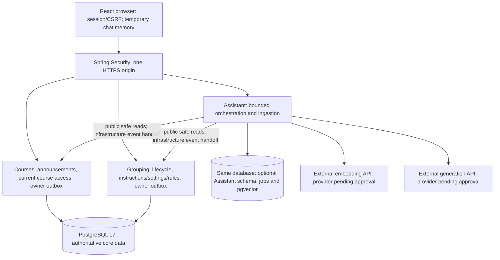

# V2 architecture and RAG design

## Status and governing constraints

Technical design finalized on **2026-10-20** after the owner's architecture discussion, extending the requirements confirmed on 2026-10-19 in the [V2 PRD](v2-PRD.md). This document extends the approved [technical stack](tech-stack.md); it is a design deliverable, not installed infrastructure or implementation evidence. [Project assumptions](project-assumptions.md) govern English-only content and America/New_York deadlines across versions. The decision register below records the choices made in this discussion; precise measured configuration and named providers remain gated.

Keep React/TypeScript and the existing Spring Boot modular monolith, one browser origin, PostgreSQL 17, Flyway-only schema changes, Hibernate validation, session/CSRF security, explicit DTOs, and the existing allocation service. No separate frontend deployment, microservice, message broker, dedicated vector database, agent tools, or paid fallback is required.

The owner approved PostgreSQL-backed course-filtered hybrid keyword/semantic retrieval (Q47) and subsequently selected **pgvector with exact search initially**, combined with English full-text search and Reciprocal Rank Fusion (RRF). Extension/version/model compatibility and free-tier capacity still require evidence; selecting this direction does not install an extension or select a provider. Do not silently add a hosted vector service if PostgreSQL validation fails.

### Approved architecture decisions

All eleven decisions were explicitly accepted by the owner during this design discussion. Selection is distinct from implementation and validation.

| ID | Accepted direction | Alternative considered and reason for this choice |
|---|---|---|
| V2-TD1 | Current-only memberships; historical request actors reference fixed activity participants | Membership episodes would require broader changes to active counts, uniqueness, allocation, and every roster query without a required membership-history feature |
| V2-TD2 | Small generation/embedding adapters using Spring HTTP clients, behind application-owned interfaces | Spring AI is viable, but the fixed non-agentic workflow benefits from explicit payload, retry, timeout, and logging control with fewer dependencies |
| V2-TD3 | PostgreSQL 17 + pgvector exact similarity search initially, plus English full-text search | Approximate indexes add recall/memory/tuning trade-offs; numeric arrays require custom similarity code. Reconsider an approximate index only with measured need and retrieval revalidation |
| V2-TD4 | External embedding APIs as the initial direction, behind `EmbeddingProvider` | In-process embeddings add model files, inference dependencies, CPU/memory, and cold-start load. Compare free external options first; evaluate alternatives with the owner if none pass |
| V2-TD5 | RRF merges keyword and semantic rankings; no additional reranker initially | Weighted scores need calibration; model reranking adds inference, latency, and quota/resource use. Tune the baseline separately from acceptance |
| V2-TD6 | Structured plain-text answer blocks with server-supplied evidence IDs | Free-form prose with embedded markers complicates reliable association and validation; schema validity still does not establish semantic grounding |
| V2-TD7 | Source-owned transactional outboxes feeding durable Assistant indexing jobs | Coalesced source markers save metadata but complicate revision-safe acknowledgement; explicit events/jobs give clearer crash and retry evidence |
| V2-TD8 | Bounded recent questions and verified previous answers, with signed course/session/text/evidence provenance | Questions-only context is simpler but weakens follow-ups referring to an earlier answer. No durable conversation storage is added |
| V2-TD9 | Separate Flyway migration set/history and explicit activation for vector-dependent Assistant data | Requiring pgvector in the core migration chain could prevent core startup even with AI disabled |
| V2-TD10 | In-memory account/course admission controls for one application instance, with restart reset accepted | PostgreSQL counters/leases support replicas/restart continuity but add shared-database traffic and lease recovery; multiple instances require a new shared-control decision |
| V2-TD11 | Core-first roadmap: lifecycle and announcements accepted before provider feasibility | Earlier feasibility reveals AI constraints sooner, but delays independently valuable core features. No provider-dependent implementation precedes the feasibility gate |

## 1. Module and authoritative-data boundaries

| Responsibility | Owner and boundary |
|---|---|
| Accounts, roles, sessions, student identity | Existing Identity; domain actors resolved from session |
| Course assignments/enrollment, announcements | Courses; public access/content interfaces return only explicit permitted fields |
| Membership, managers, requests, activity instructions/settings/rules | Grouping; rule definitions released with application behavior; public read interfaces for assistant-safe content |
| Final roster and CSV | Existing read-only Grouping Results; no Assistant dependency or writes |
| Derived chunks/vectors, ingestion retries, retrieval, answer orchestration | Assistant responsibility inside the same monolith; derived records are rebuildable, not authoritative source content |
| HTTP security, redacted errors/logging, provider transport | Existing platform conventions; platform does not become domain owner |

The planned Assistant package may call public Courses/Grouping read contracts and public identity/security contracts required for actor resolution. It cannot call Grouping business-command APIs or cross into other modules' internal packages. Courses and Grouping persist their own durable change records and expose them through public read contracts; Assistant owns durable jobs and consumption receipts. A narrow owner-owned outbox acknowledgement contract is permitted for infrastructure handoff only; it cannot change content or business state. The source modules do not depend on Assistant or platform, preserving existing dependency directions without an event bus or internal-table reach-through. Add ArchUnit coverage for the new permitted directions, acyclicity, no Assistant-to-business-mutation dependency, and Results read-only status. Provider HTTP adapters belong inside Assistant's infrastructure implementation; platform retains generic HTTP security/observability and no new domain ownership.

No public assistant-safe projection includes names, Student IDs, About me, memberships, applicant/recipient/sender identities, request history, or rosters. Derive the assistant's current settings DTO from an allowlist: activity existence, relevant deadline/configuration, instructions revision, and maintained rule references. Authorization can resolve actor/course relationships without serializing those identity records into provider context.



Identity/session resolution remains the existing Identity module; the diagram omits its ordinary calls for readability. Source owners never call Assistant, and no provider call belongs inside a domain save transaction.

## 2. Grouping transaction extension

Departure and transfer use the same READ COMMITTED activity-row lock as existing joining and request decisions. After lock acquisition, reread current authorization, participation, membership, manager, group occupancy, and deadline. Perform the final `clock_timestamp()` eligibility check immediately before the mutation.

For manager departure, choose from the remaining current members after serialization; store the single successor with the departure and successful command receipt. Emptying a group clears manager authority and closes pending attempts with the distinct `Group empty` reason in the same transaction. A manager transfer changes authority only, preserving memberships and pending requests; its authority update and successful receipt commit in the same transaction, and an injected persistence failure rolls both back.

Keep successful idempotency receipts scoped by actor/command/fingerprint. Replaying the same key cannot leave again, appoint another random successor, or transfer a second time. Reauthorize any receipt/status response and return only currently permitted information. Becoming a former manager cannot justify returning now-private group history in an old response. Internal immutable receipt facts can exist without granting a historical management-data read.

History projections determine management authorization from the current group manager, rather than trusting the original sender/reviewer field. Preserve immutable attempt actors/outcomes. Vacancies never reopen terminal attempts. Existing allocation/recovery reads the resulting memberships and preserves chosen plans; no new post-cutoff membership path is added.

## 3. Source model and revisions

| Source kind | Authority | Stable reference and change detector |
|---|---|---|
| Course announcement | Courses | Course ID, announcement ID, revision, publication/update timestamps, deletion marker |
| Activity instructions | Grouping | Course/activity ID, instruction revision |
| Activity settings | Grouping | Current authoritative allowlisted snapshot and revision/fingerprint; read fresh per question |
| Enforced grouping rule | Application-maintained Grouping documentation | Stable rule/section ID and release/ruleset version |

Derived source/chunk records carry course scope (or an explicitly application-wide rule scope), source kind/ID/revision, section/chunk locator, text, language assumption, embedding model/version, indexing state, and deterministic identity. Vectors must never be mixed across incompatible embedding models/dimensions. Generic rule content may be common to all courses, but a course question may combine it only with that selected course's content/settings.

Use internal source revisions/deletion tombstones for correctness; these do not create a teacher-facing history/restore feature. An eligible-source manifest and a content-catalog revision allow the orchestrator to detect updates, additions, deletions, and settings/rules changes during a question. Compare a scoped manifest/revision through owner interfaces; avoid an unrestricted SQL join into domain internals.

An announcement revision increments on edit; publication time remains fixed. Mutation DTOs include a version precondition. Reject a stale edit with safe conflict feedback and preserve the winning content. Reconcile uncertain creates/deletes via authoritative reads; use existing command/receipt conventions where necessary so an explicit retry cannot duplicate publication or delete a different revision.

## 4. Durable ingestion and rebuild

1. A teacher source save authorizes and validates under its owner module, persists the new revision, and records a transactional outbox event in the same database transaction. Each source owner retains authoritative text and exposes bounded pending-event reads plus conditional acknowledgement. In a short local database transaction, Assistant records the unique `(owner,eventId)` consumption receipt and durable job, then acknowledges through the owner contract. Both contracts join the caller's transaction on the same datasource; a rollback undoes handoff/acknowledgement together. Duplicate consumption is safe. Do not use the highest observed sequence ID as a committed-event watermark: a lower allocated ID can commit later. No source-to-Assistant dependency, platform dependency, direct cross-owner table write, or embedding call is needed in a domain save. Retain the latest necessary unacknowledged intent across restart and while AI is disabled, including deletion markers; only provably superseded metadata can be compacted under the policy in section 13.
2. A bounded worker discovers due indexing intents, reads the source through its public internal-service contract, checks its current revision/existence, and obtains the English plain text. Exclude all unsupported source kinds and all personal/student business records.
3. Split text along title/section/paragraph boundaries with bounded chunks and controlled overlap. Preserve section locators for citations. Chunk size, overlap, and embedding token limits are tuned against the benchmark and provider limits, not silently treated as product requirements.
4. Build keyword and semantic representations with the approved embedding provider/model. Publish only derived records for a still-current source revision; an edit during embedding makes that result obsolete. Keep pending/newest-revision state durable so a late old job cannot mark the new version indexed.
5. For deletion, make the source immediately ineligible through authority/tombstone checks; asynchronously purge old chunks/vectors. A late upsert cannot resurrect it. A failed edit-indexing job never makes the obsolete text eligible again.
6. Retry transient indexing failures with persisted attempts and capped backoff. Survive process restarts and duplicated/out-of-order intents. Classify permanent/provider-configuration failures visibly for operators without a teacher operations dashboard or logging text.

Indexing availability is separate from source-save success. Reads never enqueue work as a side effect of simply checking a status. A protected operator maintenance operation can rebuild the derived index from current sources, respecting versions and deletions; rebuilding must not modify announcements, instructions, rules, memberships, or activity history.

During rebuild/model replacement, either serve a validated compatible current index or disclose incomplete availability. Do not blend incompatible vectors or fall back to stale documents. Worker concurrency/connection/token budgets must leave resources for grouping, allocation, and normal course access. Measure the sixty-second available-dependencies freshness target and separate outage catch-up.

## 5. Per-question retrieval and generation

1. **Authorize and bound.** Resolve the server session, authorize the selected course for its current enrolled student or assigned teacher, validate English/question length, enforce per-user rate and per-course concurrency limits, and establish the thirty-second answer deadline. Request input cannot choose its effective role or authorized course set.
2. **Read authority.** Obtain the selected course's current source catalog/coverage and current activity settings (or explicit absence), plus the maintained ruleset version. Read only allowlisted source types. Authorization and version checks precede provider calls; a global search followed by filtering in browser code is forbidden.
3. **Prepare context.** Accept only bounded in-memory conversational context. Treat previous answers as interpretation context, not truth. Omit obsolete source-derived turns from provider context after revisions/deletions and re-retrieve supporting evidence. Client-supplied messages, source IDs, and claimed citations are untrusted.
4. **Hybrid retrieval.** Combine scoped English keyword/full-text and semantic search in PostgreSQL. Use course/type/version predicates in retrieval. Resolve candidate source revisions against current authority before text becomes model context; discard stale/deleted/ineligible candidates even if vector cleanup lags. Include current rule/settings evidence where the question needs it.
5. **Rank evidence.** Merge the keyword and semantic rankings with RRF, deduplicate by stable source/section, and rank a bounded distinct-source set. Aggregate bounded chunk evidence per source so long documents do not gain unlimited votes. Evaluate the top five distinct source results against each question's required source set. Multiple chunks of one source do not count as five different sources. No model reranker is part of the initial design; any later addition needs measured justification, quota/latency review, and acceptance revalidation. RRF parameters/candidate counts are tuned on development cases, not the frozen acceptance questions; a high rank is not a confidence guarantee.
6. **Handle weak evidence.** With insufficient evidence, produce an explicit limitation, not general-knowledge invention. If coverage is pending/failed, identify incomplete search and link to normal course pages; do not claim that no teacher information exists. Source availability or configured-activity absence is authoritative state, not an inference from empty vector results.
7. **Generate.** Send only the English question, bounded relevant context, permitted current evidence, and an explicit answer/citation contract to the approved external generator. The instruction hierarchy treats retrieved text as untrusted data. No SQL execution, arbitrary tools, URL fetch, domain mutation, or permissions granted by source text.
8. **Validate output.** Parse bounded structured answer/citation output. Reject invented source IDs, unsafe links/markup, malformed output, unsupported personal-data answers, and invalid citation mappings. Use trusted server-generated links and escaped rendering. Technical validators cannot alone prove semantic truth; human quality evaluation remains required.
9. **Validate delivery.** Buffer the whole response and perform final current authorization, source existence/revision, content-catalog, ruleset, and settings checks. Changes or revoked access withhold the answer and return safe retry feedback. This short validation point defines answer eligibility; it does not promise to prevent later teacher edits after delivery. Later edits follow the earlier-answer changed/unavailable policy.
10. **Deliver and release.** Return the complete English answer and validated citations, or safe abstention/unavailability/conflict feedback. Release the in-flight slot in all success/error/disconnect paths. Never stream partial answers or automatically replay a failed question. Count failures/timeouts against the agreed short-term limit.

No domain activity lock or long-lived database transaction spans an external provider request. Reauthorization/source-validation reads use short consistent operations through public boundaries. If the overall deadline is reached, discard late provider output; an SDK retry policy must not bypass the wait limit or create uncontrolled free-quota consumption.

## 6. Citation, session, and cache boundaries

A citation identifies a stable authorized source and section plus the version used for the answer. The citation endpoint checks the current relationship and current source state. It serves current content or changed/unavailable feedback, never an old deleted body from vector storage. Rule citations link to readable application-maintained sections; settings citations link to the permitted current activity view.

The browser holds the current transcript in memory. Reload, leaving the assistant, course switch, session loss, and logout clear it. Recheck known citation versions on later questions/citation opens to mark older displayed answers. No push subscription, durable transcript, service-worker answer cache, analytics replay, or administrator chat export is introduced. Use private/no-store response handling and redact request-scoped content on every observability path. Embedding/source indexes are the agreed rebuildable knowledge data, not conversation/answer caches.

Server-side auth may use account identifiers to enforce rate limits without forwarding identities to AI. Avoid user-content logging in exception handlers and provider client diagnostics. Source text contains teacher-authored course content, which may itself include personal data; the content assumption and notice do not constitute guaranteed anonymization.

## 7. No-cost provider validation and configuration

The first AI milestone compares free generation and embedding candidates using synthetic English course content. For each candidate record dated official terms and actual account eligibility; model/embedding IDs, dimensions/context limits, release/pin compatibility; training/retention and geographic processing policy; request/token/concurrency limits; billing controls and behavior at quota exhaustion; cold/warm latency; embedding and generation benchmark scores; and combined workload cost/quota observations.

Do not name a provider as approved before the owner reviews that concrete evidence. A free label is not proof of zero charges, sufficient quotas, or permanent availability. Provider selection approval does not authorize deployment or changes to the accepted privacy/product constraints. If no candidate passes, keep the assistant disabled and return the failed gate and options to the owner.

Generation/embedding adapters, model IDs, indexing version, prompts, retrieval parameters, and rate budgets are server configuration. Keys are secrets outside source/frontend builds. Keep the assistant default-disabled until its configuration and acceptance evidence are present; core features have no dependency on provider initialization. Restrict outbound destinations to the chosen adapters; no model-directed arbitrary network access.

## 8. Failure matrix and verification responsibility

| Failure/race | Required response | Evidence |
|---|---|---|
| Domain save succeeds; embedding provider down | Save remains successful; durable pending indexing; current obsolete text excluded | PostgreSQL transaction/outage test |
| Old ingestion job completes after edit/delete | Discard obsolete job output; cannot resurrect source | Coordinated worker integration test |
| Provider answer arrives after source change/revocation | No answer body delivered; explicit retry/access feedback | Controlled in-flight E2E/API test |
| Model emits fabricated citation or executable markup | Reject invalid citation/output; render safely; no partial response | Output-contract and browser tests |
| User switches course or tampers with context/source ID | No cross-course search, source disclosure, or transcript reuse | Direct API and browser denial tests |
| Free capacity exhausted or generation exceeds deadline | Safe unavailable feedback/links; no paid fallback or automatic retry | Provider adapter/quota controls plus actual free-provider observations |
| Process restart during indexing/rebuild | Resume durable current-version work; preserve authoritative content | Real PostgreSQL restart/recovery evidence |
| AI resource saturation | Bounded work; core journeys and allocation continue | Load/isolation test at planned workload |
| Source/rules/settings absent or conflict | Explicit state/grounded conflict; no fabrication | Human-reviewed benchmark and deterministic scenarios |

This architecture is validated through the [roadmap](v2-implementation-roadmap.md). The sixty-question benchmark and performance/indexing gates are defined in [PRD section 7](v2-PRD.md#7-acceptance-and-release-gates). Current local Docker failures, remote CI allowance, hosted scheduling/cold-start/monitoring/recovery/quota validation, and deferred backup/tuning remain separate open gates; AI approval cannot close them.

## 9. Repository fit and physical data design

The reviewed V1 baseline is Java 25/Spring Boot 4.1.1 with targeted JDBC SQL, React/TypeScript, PostgreSQL 17, migrations V1 through V9, and no implemented Assistant/provider interface. Names below are intended contracts/tables, not claims that they exist. Keep exact installed pins until compatibility evidence supports a change.

### Lifecycle migration and integrity

- Preserve `activity_membership` as current state: primary key `(activity_id,account_id)`, group/participant FKs, and the deferred `group_manager_is_member` FK from `activity_group`. Do not retain departed rows here. Do not cascade-delete retained requests.
- Forward-migrate the historical manager FK in `application_attempt` and sender FK in `invitation_attempt` from current memberships to `(activity_id,account_id)` in `activity_participant`. Keep their original IDs and group/activity links. Both existing cancellation checks must add `Group empty`. Existing applicant/manager and recipient/sender inequality checks remain valid on new attempts.
- The current application field `manager_account_id` records the manager at submission; it is not a complete reviewer audit. Do not present it as the actual deciding actor after succession. If the decision path records `decided_by_account_id` and `decided_at`, preserve those immutable facts with participant integrity; leave unrecoverable legacy attribution unknown rather than infer it. Original invitation senders are never rewritten.
- Use the existing actor/command/key/fingerprint receipt pattern. Include source group and transfer target in fingerprints. Successful departure, random successor, cancellations, and receipt commit atomically. A duplicate successful departure must never remove a later rejoined membership; it returns a reauthorized acknowledgement/current projection without executing again.
- Check current-manager authority for application decisions, invitation sends, history, cursors, and receipt response projections. The V1 check requiring the original stored manager to equal the decision actor must be removed for V2. Former-manager sender/manager IDs remain history, not permission. Preserve applicant/recipient access to their own attempts after authority changes.
- Select the successor uniformly from remaining members under the activity lock using established Java randomness, then persist that one choice. Tests prove candidate eligibility, one-candidate behavior, rollback, and replay stability; a flaky frequency assertion is not required. Never relax the final database-time check or appoint managers through system allocation.

### Courses-owned announcement records

| Record | Intended fields and integrity |
|---|---|
| `course_announcement` | UUID ID, course FK, current title/body, fixed `published_at`, `updated_at`, positive monotonic revision, nullable `deleted_at`; active rows enforce required nonblank 150/10,000-code-point limits and existing valid-Unicode conventions |
| Deleted announcement metadata | Preserve only stable ID/course/revision/deletion and necessary timestamps; clear title/body on deletion. No content archive, restore API, or receipt response snapshot |
| Courses command receipt | Actor/course/command/key/fingerprint, target ID and minimal committed revision/deletion acknowledgement; unique actor/command/key. Courses owns it; do not reuse Grouping's receipt table, which requires an activity FK |
| Courses outbox | Unique event ID, course/source key, revision, change kind, creation time, conditional acknowledgement metadata; no title/body, questions, or generated text |

Index active announcements by `(course_id,published_at DESC,id DESC)`; use a bounded actor/course-scoped keyset cursor. Editing leaves publication time unchanged. Conditional edit/delete compares `expectedRevision` and affects exactly one current row. Source content/revision, catalog metadata, receipt, and outbox event commit together. Bind the receipt fingerprint to command kind, course/resource and every command input, including expected revision and exact validated title/body where present; store the digest, not content. Same-key/same-input replay returns a currently authorized minimal acknowledgement, while a changed payload or target returns key-reuse conflict without execution. Replayed receipts require current teacher assignment and return only minimal permitted acknowledgement/current state. Receipt retention must not make old creation keys duplicate announcements. Deletion confirmation is a UI requirement; backend authorization and revision checks remain mandatory for direct calls.

### Source authority and derived Assistant records

Grouping adds a monotonic instructions revision and durable outbox events on successful creation/instruction edits, including after finalization. Current settings have a revision/fingerprint covering activity existence, deadline, relevant fixed configuration, and current time-derived phase. A question crossing cutoff must detect a phase change even if no scheduler has materialized state. Additions/deletions are detected through per-owner course catalog tokens or a deterministic manifest digest, not only checks of already-cited IDs. Rules are versioned application resources with stable section IDs, aligned with behavior releases; deploy/startup reconciliation records durable ingestion work for changed rule versions without a status-read mutation.

| Assistant-owned record | Intended purpose |
|---|---|
| Consumption receipt | Unique `(sourceOwner,eventId)` makes handoff duplicate-safe |
| Ingestion job | Source key/revision/index generation, state, attempts, next attempt, lease owner/expiry/fencing token, safe failure category; uniqueness prevents duplicate logical work |
| Index generation | Embedding provider/model/revision/dimensions/distance metric, chunker/ranking configuration versions, compatibility and activation state |
| Derived source/chunk | Selected-course scope or explicit global-rule scope, source revision, section/chunk ordinal, text/hash, English `tsvector`, `vector(d)` embedding; unique source/revision/generation/chunk identity |
| Coverage metadata | Durable indexed/desired revision and pending/failed state, exposed only as safe completeness information |

Use B-tree scope/source/revision indexes and a GIN full-text index. Exact vector distance search uses compatible eligible rows without an HNSW/IVFFlat index initially. Select `d`, distance metric, chunk size/overlap and budgets from the approved model and measured benchmark; do not mix dimensions/models or assume cosine is correct for every model. A replacement model uses a new generation/table or other dimension-safe representation; migration and rebuild cannot reinterpret existing vectors. Source tombstones are authoritative in owner modules, and Assistant publication/purge remains idempotent. No conversation, prompt, answer, or user-rate table is introduced.

## 10. REST and public service contracts

These are the intended API shapes, following current course-scoped routes. Implementation may refine naming consistently without changing these semantics. Browser writes use session authentication and CSRF; client actor/role fields are forbidden. Strict DTOs reject unknown/invalid fields and redact their string representation.

| Method and route | Request / result | Service authorization and failure behavior |
|---|---|---|
| `POST /api/courses/{courseId}/groups/{groupId}/leave` | `{commandKey}`; minimal committed acknowledgement and privacy-safe current grouping state | Current enrolled student + fixed participant; actor must currently belong to the specified group on first execution; activity lock/final cutoff check. No target student field |
| `POST /api/courses/{courseId}/groups/{groupId}/manager-transfer` | `{commandKey,targetMemberId}`; acknowledgement/current permitted state | Current manager to a different current member of this group; recheck after lock; membership unchanged |
| `GET /api/courses/{courseId}/announcements` | Bounded cursor page of active notices, revision and publication/edit times | Current enrolled student or assigned teacher; works without activity; cursor is no permission grant |
| `GET /api/courses/{courseId}/announcements/{id}` | Current active notice | Reauthorize course/resource; deleted or inaccessible notice does not disclose old body |
| `POST /api/courses/{courseId}/announcements` | `{commandKey,title,body}`; stable ID/revision acknowledgement | Any assigned teacher; immediate publication and atomic receipt/outbox |
| `PUT /api/courses/{courseId}/announcements/{id}` | `{commandKey,expectedRevision,title,body}` | Any assigned teacher; stale revision rejected, no overwrite/auto-resubmit |
| `POST /api/courses/{courseId}/announcements/{id}/delete` | `{commandKey,expectedRevision}`; minimal deletion acknowledgement | Explicit confirmed browser action; POST command matches existing conventions and avoids a DELETE request body |
| `GET /api/courses/{courseId}/announcement-commands/{commandKey}?command=...` | Actor-scoped minimal receipt status; no content snapshot | Current assigned teacher and original actor; reconcile uncertain writes via receipt/current resource before any explicit retry |
| `GET /api/courses/{courseId}/assistant/status` | Enabled/available and safe coverage/limit configuration | Current course access; no provider secrets, internal job details, domain writes or enqueue |
| `POST /api/courses/{courseId}/assistant/questions` | `{question,context?}`; complete outcome/blocks/citations, changed-reference markers, signed context | Current course access, CSRF, size/language/admission checks; new explicit attempt only, no automatic replay or cached answer |
| `GET /api/courses/{courseId}/assistant/sources/{kind}/{id}?version=...&section=...` | Authorized current source/section and current/changed/unavailable state | Stable allowlisted source resolution; a citation is no capability and never serves an obsolete index body |

Use safe RFC 9457 responses and existing conventions: 400 invalid input, 401 session loss, 403 CSRF/denial where appropriate, non-enumerating 404 inaccessible resources, 409 revision/state/key conflict, 429 admission limits with retry guidance, and safe 503 AI/configuration/provider/overall-timeout unavailability. Definitive semantic abstention/conflict is a successful answer outcome, distinct from transport/provider failure. Failure feedback includes only trusted course links and never raw provider errors. Core writes do not automatically retry after uncertain responses.

Courses exposes an actor/course authorization projection separate from content returned to the provider. Grouping exposes a narrow assistant-safe instruction/settings/rules contract. `ActivityCourseAccess.Access` currently includes account/enrollment IDs, and `GroupingActivities.workspace` additionally requires fixed participation: neither is an assistant evidence DTO. **A late-enrolled student is assistant-authorized under the PRD but is not made an activity participant.** The dedicated source/citation view authorizes current enrollment and reveals only allowed text/settings/rules; it does not widen the normal grouping workspace or expose membership. Add explicit Spring Security matchers to the current deny-all chain and enforce resource authorization again in services.

Internal source contracts expose current manifests, current allowed bodies, bounded pending events, and conditional infrastructure acknowledgement. They are in-process public Java interfaces, not browser endpoints. Public read types for Assistant must be separate from command interfaces so ArchUnit can forbid Assistant dependencies on grouping/content mutations while permitting the narrowly scoped outbox handoff. Operator activation/rebuild/compaction runs only as an opt-in, non-web maintenance command/profile invoked through authorized local or host/container shell access with backend credentials. OS/host execution permissions and secret access define that privilege boundary; no HTTP management endpoint, product admin role, browser account, or scheduler bearer grants it. The command must not start the web listener, log content/secrets, or reset domain data. Tests prove browser/student/teacher/scheduler requests cannot invoke maintenance. Hosting without appropriate shell/maintenance access cannot claim this operational gate passed.

## 11. Provider transport, answer schema, and admission

The planned `EmbeddingProvider` accepts only bounded permitted text batches or a question and returns validated finite vectors with exact model/dimension metadata. The planned `GenerationProvider` accepts a bounded evidence request and returns a bounded response plus safe usage metadata. These interfaces do not exist in V1 yet. Small Assistant infrastructure adapters use Boot-managed Spring HTTP facilities; no Spring AI, reactive rewrite, agent framework, or automatic provider fallback is selected. Configure allowed destinations, TLS, request/response size, connect/read/overall deadlines, and disabled content logging. Keep automatic question retries off; durable ingestion backoff belongs to the worker, not a hidden transport retry loop.

The model output contract is conceptually:

```json
{
  "outcome": "ANSWER",
  "blocks": [
    {"text": "A bounded English factual statement.", "evidenceIds": ["e1"]}
  ]
}
```

Allowed semantic outcomes are `ANSWER`, `INSUFFICIENT_EVIDENCE`, and `CONFLICT`; unavailable/configuration/authorization outcomes are server decisions. Factual blocks require supporting evidence IDs from this request's trusted manifest; limitation/greeting text cannot be used to hide unsupported factual statements. Validate bounds, allowed fields/outcomes, plain-text policy, evidence existence/section mappings and expected citation requirements, including both sides of known conflicts. Never execute or auto-link model HTML, Markdown, or arbitrary URLs. Generate clickable citations from server routes. Use provider-native schema support only if evaluated; always perform server parsing/validation. Reject malformed/truncated output safely without a corrective automatic generation call. Mechanical validation cannot prove entailment or perfectly detect language, personal-status questions, injection, or contradictions; deterministic safeguards plus the human-reviewed/adversarial gates remain necessary.

Admission uses bounded process-local state: a rolling sixty-second account-level allowance shared across all courses/sessions/tabs, two in-flight questions per course, and a measured global AI cap. Authenticate/authorize and enforce request bounds before spending provider quota. Admitted attempts count even on provider failure/timeout; no client-only accounting and no unbounded waiting queue. Bound rate-map retention/cardinality and expire inactive entries without retaining content. Process restart resets counters by the owner's accepted trade-off; durable indexing jobs do not reset. Deploy exactly one application instance; replicas/overlapping active revisions would require shared admission controls and a new design review.

Use dedicated bounded answer/ingestion execution and HTTP connection budgets, not unrestricted common-pool work. The response deadline is thirty seconds end to end, including queue/admission handling, retrieval, both provider stages and final validation; do not give each stage thirty seconds. Cancel expired/disconnected work and discard late output. Release the user-facing course slot on termination; any transport that cannot immediately stop must retain a global resource permit until physically complete, preventing repeated timeouts from accumulating background work. Give ingestion a separate bounded budget and shared provider quota accounting so rebuilds cannot monopolize question embeddings or generation. An embedding failure produces safe unavailable feedback for a question; no silent keyword-only quality downgrade is accepted.

## 12. Signed temporary context and freshness

The browser keeps bounded user turns, displayed answers, citations, and signed context envelopes in component memory only. An envelope binds the exact prior answer text/blocks and evidence manifest to the authenticated session, course, owner catalog tokens, settings/rules versions, issued time/expiry, schema version and key ID. Use an application-managed server-only signing key separate from scheduler/provider secrets, established MAC/signature facilities, canonical bounded serialization and constant-time verification; do not invent cryptography. Never put envelopes or transcript text in URLs, cookies, session attributes, persistent storage, logs or error telemetry. Signing is integrity protection, not encryption or evidence of truth.

On every follow-up, authorize the current course, enforce aggregate context size/turn/token limits before expensive work, verify envelope signature/session/course/text binding, and compare the current catalogs/settings/rules/source versions. Modified/cross-session/cross-course envelopes are rejected without trusting their claimed provenance. Expired or source-obsolete envelopes are excluded, corresponding earlier references marked changed/unavailable when detected, and the current explicit question may proceed with fresh evidence and safe context-loss feedback. Drop dependent older assistant context conservatively rather than preserve an indirect stale claim. Previous user messages remain untrusted user context, never evidence; no promise of automatic sensitive-data detection/redaction is made. Context budget, signing-key rotation and expiry are technical configurations measured/tested before acceptance; key rotation may safely discard context and require clarification.

Fresh retrieval is mandatory even for a correctly signed prior answer. No previous answer overrides retrieved evidence or current permissions. Use short consistent manifest snapshots through owner APIs for evidence assembly and a fresh final validation snapshot after provider completion. Recheck additions/deletions, not merely retrieved sources, and include time-derived activity phase. If access or applicable versions changed, withhold all generated text; do not transparently regenerate. The validation snapshot is the eligibility point, not a guarantee that content/access cannot change after delivery. Citation open always performs a new check and serves only current content or safe changed/unavailable feedback. No real-time push or obsolete-body retrieval is introduced.

## 13. Worker recovery and activation/deployment design

Jobs transition through pending/leased/retry-wait/complete/superseded states with persisted attempts and safe error classifications. Claim a bounded batch in a short transaction; use lease expiry plus a fencing token/conditional completion so a delayed expired worker cannot overwrite a newer result. Never hold a JDBC connection, domain lock, or transaction while embedding. Check current source/revision/generation both before provider use and at publication; even if an edit races publication, authoritative retrieval/final-delivery checks exclude the obsolete rows. Failed indexing remains durable; configuration/permanent failures can stay blocked for operator correction without a tight retry loop or a teacher repair UI.

Outbox storage must also work if V2-5 never finds a provider. Each source save still appends its own event. Owner-controlled bounded housekeeping during subsequent source writes, plus explicit non-web maintenance for accumulated backlog, may remove older unacknowledged events only when a newer committed intent for the same source supersedes them. Serialize compaction with owner revision writes and short relay claims/acknowledgement; never discard the newest required intent, an unrepresented deletion, or a failed current-revision job. Keep the authoritative source/tombstone and at least the latest unacknowledged intent for each source; activation reconciles all current source metadata/tombstones in addition to consuming pending events. This bounds obsolete edit-event growth per source without replacing the event write protocol with a mutable single-marker design. Acknowledged events may be purged only after durable job/consumption safety; stale job/receipt retention has its own measured maintenance policy. No read performs cleanup, no provider is required, and no extra wake/keep-alive is introduced. Compaction/relay/edit/delete races need PostgreSQL tests in the announcement and worker slices.

Metadata for distinct sources/deletions and retained command keys still grows with real usage; this design does not promise infinite no-cost storage. Measure bytes per active/deleted source, pending/superseded event/job and receipt, exercise an extended AI-disabled editing workload, and document storage headroom/maintenance thresholds before core acceptance and again at joint quota validation. Never drop tombstones or idempotency guarantees just to fit a quota. If safe retention cannot fit, report the operational limit and evaluate alternatives with the owner rather than silently lose work or impose a new product cap.

One in-process ingestion worker starts catch-up and bounded scheduled reconciliation when AI is configured. Do not rely solely on an in-memory wake signal or browser reads. Sleeping/offline applications cannot index; the sixty-second target applies while the application and dependencies are available, with outage catch-up separately reported. Do not add keep-alives, a message broker, a second hosted worker, or change the allocation scheduler contract to conceal sleep. Its authenticated production 204 remains a bounded allocation invocation, not proof of assistant processing or hosted reliability.

**Existing instruction conflict requiring reconciliation:** repository `AGENTS.md` still describes an authenticated ordinary scheduler 501 until due-work authorization, while the inspected `SchedulerController` invokes `DueWork` and declares 204 and the dated V1 slice 8–12 records describe implemented allocation. This document records that observed mismatch; it does not amend the controlling instruction, authorize scheduler changes, or treat HTTP success as hosted evidence. Before a later implementation task relies on scheduler expectations, reconcile the instruction with the owner's V1 authorization/evidence. No scheduler or `AGENTS.md` was changed here.

Keep existing core migrations/history and Hibernate core validation intact. Vector-dependent Assistant tables use a separate Flyway migration location/history in an Assistant schema, applied by an explicit maintenance command before activation, not core startup. Extension installation is database-level prerequisite work with appropriate permissions; Assistant table migrations must not own/drop core objects or the shared extension. Maintain separate version numbering/history and schema-qualification; do not add optional locations to the same core history. Assistant persistence uses explicit JDBC/SQL rather than unconditional JPA mappings that would make core Hibernate validation require optional tables. Disabled/missing/incompatible Assistant schema leaves the core application startable and AI safely unavailable; it must not become a failing Spring bean or core health dependency. An enabled-but-invalid configuration reports a safe unavailable state and operator metadata, not partial answers.

The single existing non-root image continues serving React and APIs; no extra Python service or vector service is selected. One PostgreSQL 17 database holds core data and optional derived Assistant data. A pinned pgvector-capable PostgreSQL 17 image/extension must be validated for local/Testcontainers/CI and any host before use; upgrading local infrastructure must preserve the persistent project volume and loopback 5433, leaving the unrelated 5432 service alone. Migration tests include core-only/no-extension startup, upgrade of populated V1 history, explicit Assistant activation, partial/failed activation, schema mismatch, and no content loss. AI enablement follows approval and acceptance; disabling it is an immediate configuration rollback that leaves core data intact. Revert artifacts only when compatible with both migration histories; otherwise forward-fix. Rebuild derived data rather than restore incompatible vectors, but never rebuild/reshuffle authoritative allocation plans.

The current main Hikari pool is configured for five connections. Keep AI database transactions short and capped; measure whether a small separately bounded Assistant JDBC pool is warranted within the same total host connection budget. Do not silently raise shared pools or reserve every connection for AI. Load tests must observe core login/announcement/grouping/allocation/export correctness and latency while indexing/questions are saturated. Count heap/native memory, buffered answers, model payloads, SQL work, workers, sessions, scheduler polling, storage and network together. Existing 512 MiB image observations are historical local evidence, not an accepted AI capacity measurement or a hosted guarantee.

## 14. Provider comparison, cost model, and acceptance trace

Provider selection remains **NOT SELECTED / NOT RUN**. No account, live AI request, extension installation or deployment was performed during this design. External generation and external embedding are the initial direction; if no free pair passes, keep AI disabled and evaluate alternatives with the owner before finalizing a provider. Alternatives may include local embeddings, a different free pair, or an explicit requirement revision; no automatic fallback or undisclosed change is allowed.

The core-first feasibility report must compare generation and embedding as a pair using synthetic English content. Record official policy dates/links and actual account observations separately. Cover training use (permitted by the owner but disclosed), retention/deletion, subprocessors/geography/account/institutional restrictions, and the fact that teacher/user-entered text can contain personal information. Do not describe provider retention as application memory-only storage. Free-tier labels do not establish billing safety: verify no-charge account controls and exhaustion behavior, including any payment method/overage path, before calls are authorized.

| Workload | Measure for the joint generation/embedding budget |
|---|---|
| Initial indexing | Current source count, chunk count, source tokens, batch/request limits, embedding tokens/time and storage |
| Content updates | Changed chunks/revisions, duplicate/superseded work, retry consumption, update latency and backlog growth |
| Full rebuild/model change | Full corpus embeddings, temporary dual-generation storage, completion time, interference with questions and quota headroom |
| User question/follow-up | Query embedding plus retrieved/context/input/output generation tokens, requests, concurrency, warm latency and thirty-second deadline |
| Failure/recovery | Quota exhaustion, throttling, outages, provider errors, restart/catch-up, unknown/failed requests and bounded retry consumption |
| Combined core operation | PostgreSQL/session/scheduler compute, connections, storage, outbound network, application memory/threads, hosted cold starts and unattended behavior |

Show estimates from measured corpus/token counts, then actual counts; do not assume an average announcement length or unlimited free embeddings. Provider metrics include p50/p90/p95 successful latency, failure/throttle counts, observed quota windows, model/dimension/context limits, allowed caching/batching, structured-output behavior and reliability over the agreed observations. A missing account/prerequisite is NOT RUN, not a model-quality failure. Owner approval follows the concrete comparison; exact released pins and resource budgets are frozen with the evaluated configuration.

| Gate | Required evidence and release effect |
|---|---|
| Lifecycle/announcements (AC-01/02) | Frontend/build, real PostgreSQL 17 migrations/integrity/races, ArchUnit, real-backend authorized and denied browser flows; can accept independently with AI absent |
| Retrieval (AC-03) | Human-frozen 40 answerable/20 unsupported minimum, separate development tuning set; at least 38/40 all-required sources in top five distinct eligible results |
| Answer quality (AC-03) | Actual approved pair: at least 36/40 fully correct, 19/20 correct abstentions, at least 95% supported factual claims, 100% valid authorized citations; human-reviewed raw counts/failures |
| Security/freshness (AC-02/03) | Extra deterministic/adversarial cases outside the sixty, including source edits/deletes/additions, revocation in flight, signed-context forgery/staleness, unsafe output and direct/cursor/replay access. Any observed unauthorized disclosure/action blocks affected release |
| Performance/recovery (AC-04) | Ten-user spread and concentrated-course load; 90% successful warm answers within fifteen seconds, thirty-second wait cap; current indexing within sixty available seconds, restart/out-of-order/lease/rebuild evidence, core isolation and combined free quotas |
| Operational (AC-05) | Separate current Docker/image/private-CI and hosted cold-start/scheduling/monitoring/recovery/quota gates; deferred backups/tuning remain explicit. No local test or plan closes them |

Freeze model/embedding IDs, corpus/rules versions, prompt/schema, chunker/RRF settings, context limits and rubric for each acceptance run; preserve failures and distinguish provider doubles from actual provider quality. Revalidate after material changes. Report clock/window definitions and all failure/throttle denominators; fast errors never satisfy successful-answer performance. Technical validation cannot silently relax provisional PRD thresholds.

### Research sources and limits

Consulted during design on 2026-10-19/20: [Spring REST clients](https://docs.spring.io/spring-framework/reference/integration/rest-clients.html), [Spring AI compatibility](https://docs.spring.io/spring-ai/reference/getting-started.html) (alternative only), [pgvector exact/approximate search and filtering](https://github.com/pgvector/pgvector#readme), [Neon pgvector support](https://neon.com/docs/extensions/pgvector), and the [original RRF paper](https://plg.uwaterloo.ca/~gvcormac/cormacksigir09-rrf.pdf). These support technology capabilities and trade-offs, not this account's free entitlement, measured application performance, security acceptance, or approved provider selection. Recheck current released versions/terms at feasibility.
