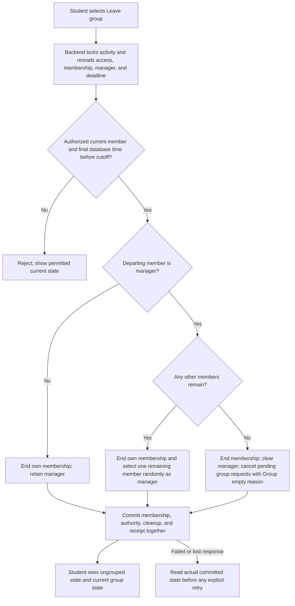
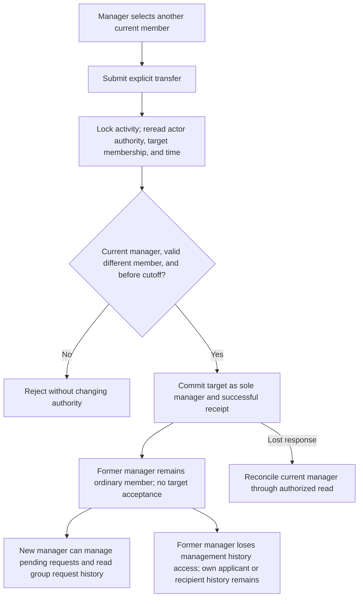
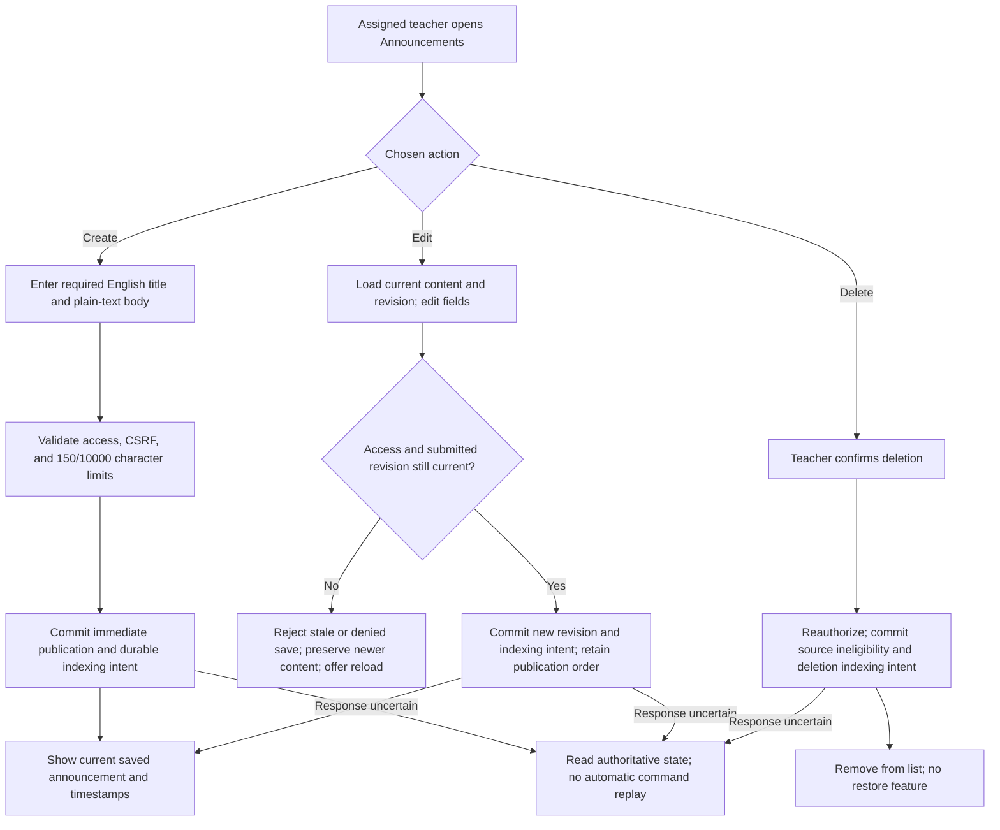
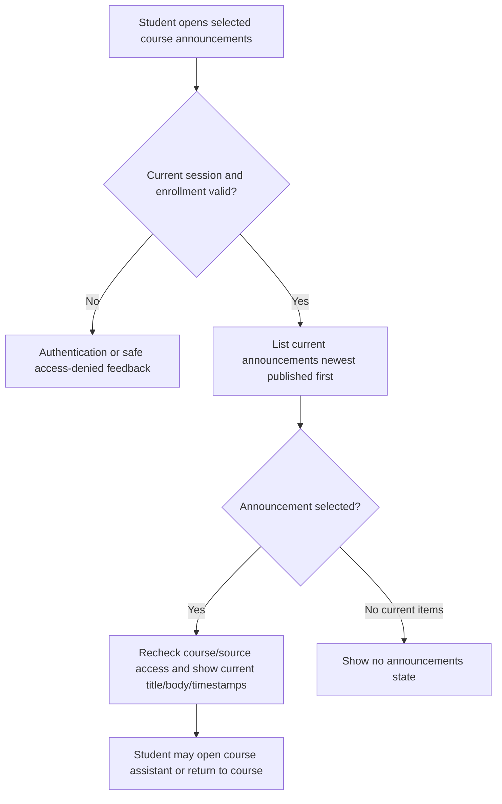
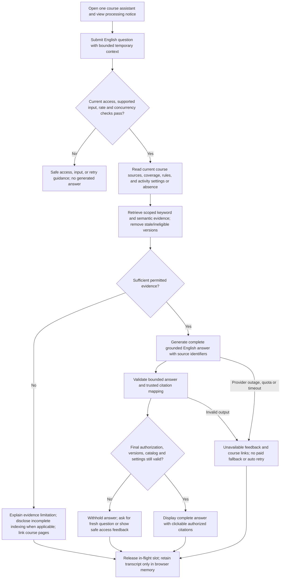
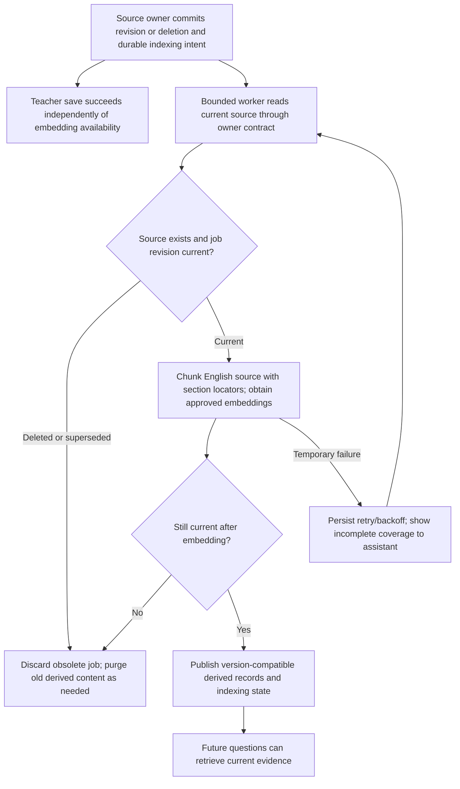
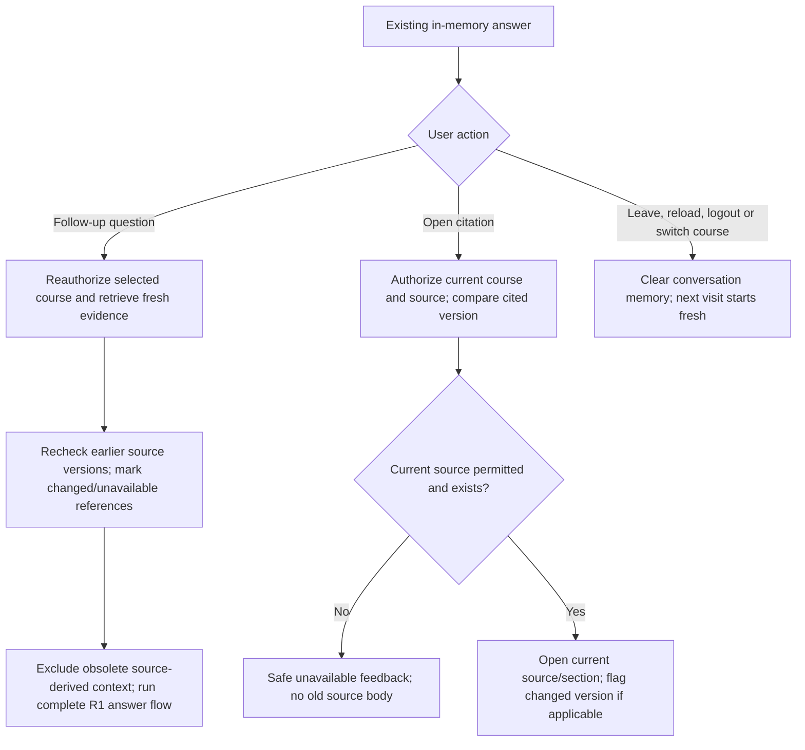

# Classroom Grouping System — V2 user flows

**Status:** Confirmed requirements documented on 2026-10-19 after Q79. These flows implement the [V2 PRD](v2-PRD.md) in design only; no new business code or provider selection is authorized. See [architecture](v2-architecture.md), [roadmap](v2-implementation-roadmap.md), and [project assumptions](project-assumptions.md).

All user-facing text/content is English. Deadline input/display is labeled America/New_York with daylight-saving handling; nonexistent and ambiguous input wall times are rejected. Authentication, course relationship, resource authorization, CSRF on browser commands, safe errors, and mutation-free status reads apply throughout. UI labels below express intent rather than immutable route/endpoint names.

## G1. Student leaves a group, including manager departure

**Actor/trigger:** Current member opens their group before cutoff and explicitly chooses Leave group. There is no approval request to another person and no removal action targeting someone else. Covers GL-01, GL-02, GL-05, GL-06.

**Success:** Ordinary departure retains the current manager. Manager departure with remaining members appoints a random current member without acceptance; one remaining member is the successor. Last-member departure keeps the empty system-created group, name, and capacity. Pending attempts in a newly empty group close with a distinct system reason; completed attempts remain unchanged.

**Return/switch continuation:** The ungrouped student may use ordinary joining/application/invitation routes immediately, including to the former group. No destination reservation or manager restoration. If another student fills the vacancy first, normal capacity conflict feedback applies. A vacancy does not reopen terminal requests. If cutoff arrives before a later join, the student remains subject to normal automatic allocation, possibly back into the former group.

**Failure/race:** Course/participation/membership loss, already-left state, cutoff after lock wait, rollback, lost response, duplicate key, simultaneous departures, or last-place competition. No partial departure/succession/cleanup. A replay cannot choose a new successor. G1 never changes finalized state or fixed participants/capacities.

## G2. Manager transfers authority; history access follows current role

**Actor/trigger:** Current manager selects another current member and explicitly transfers the role. Covers GL-03, GL-04, GL-06.

**Pending work:** Existing requests survive transfer, including invitations originally sent by the former manager. Preserve original request actors/outcomes. Every subsequent request decision/history page checks current authority; stale browser controls/cursors and old successful-response receipts cannot grant former-manager access.

**Failure/race:** The target leaves first, the actor transfers authority in another command, cutoff passes while waiting, or a stale former-manager approval/invite races. Serialize and recheck. No co-manager/delegation, membership movement, teacher transfer, or transfer after cutoff. The new manager's later departure returns to G1.

## A1. Teacher publishes, edits, or deletes a course announcement

**Actor/trigger:** Assigned teacher opens course Announcements. The course need not have a grouping activity. Covers AN-01–AN-04.

**Validation:** Reject blank/oversized/invalid plain text; render stored text escaped. An assigned teacher may edit/delete another assigned teacher's announcement in the same course. Unauthorized direct requests change nothing. Two teachers' conflicting edits cannot silently overwrite the winning revision.

**Success:** Publication is immediate. List ordering uses publication time, newest first; editing changes last-edited time without moving the item. Show times in the university timezone. Deletion removes ordinary and assistant-source access immediately, without exposing old text through citations. Indexing outages do not turn a committed source save into a failure.

**Excluded continuations:** No draft/publish approval, schedule, attachments, comments, rich text, restore, push/email, or read receipts.

## A2. Student views announcements for an enrolled course

**Actor/trigger:** Enrolled student selects Announcements from their course workspace. Covers AN-02–AN-04.

Announcements predating enrollment are visible if still current. Revocation blocks later reads, direct links, and citations. A deleted item gives safe unavailable feedback; it is not restored from browser/server cache. No grouping activity is required, and no grouping deadline blocks announcements. Teacher edit/delete controls never appear as student permissions and direct calls cannot bypass denial.

## R1. Student or teacher asks a course question

**Actor/trigger:** Enrolled student or assigned teacher opens the selected course assistant, sees the external-processing notice, and submits an English question. Covers RA-01–RA-07.

**Question-specific branches:**

| Situation | User-visible outcome |
|---|---|
| No grouping activity | Explicitly state no activity is configured; still answer from current announcements/general rules if supported |
| Personal membership/status question | Explain scope and direct to existing group screen; do not retrieve membership records |
| Teacher content conflicts with enforced rules | Cite both relevant sources, explain enforced rule, suggest teacher clarification |
| Announcements conflict without explicit replacement | Cite both, flag ambiguity, ask for teacher clarification; newest does not automatically win |
| Unsupported-language input or request for translation | English-only feedback/English response; no translation or cross-language retrieval |
| Too long/rate limited/course concurrency full | Explain limit and retry guidance; do not silently queue/resubmit or bypass server limit |
| Index pending/failed | Disclose incomplete sources and link normal pages; do not assert teacher information does not exist |
| AI disabled or free capacity exhausted | Assistant unavailable; course pages and grouping remain usable |

**Delivery:** Only complete validated answers. No streaming partial text, arbitrary links/tools, general-knowledge guessing, or course mutations. Every terminal path releases processing resources; timed-out output is never delivered later as if still requested. Failed provider calls count toward short-term limits.

## R2. Teacher source change propagates to retrieval

**Actor/trigger:** A1 source change, activity-instruction change, maintained-rules release, or authorized index rebuild. Covers RA-04, RA-07 and architecture ingestion requirements.

Stale source eligibility ends at authoritative save, not at eventual vector deletion. An older delayed job cannot overwrite the latest revision or resurrect a deleted source. Worker restart and rebuild preserve source content and business state. Reads do not trigger domain changes. The target is searchable current content within sixty seconds when dependencies are available; outage catch-up is reported separately.

## R3. Follow-up question, changed source, and citation open

**Actor/trigger:** User continues an in-memory conversation or opens a citation. Covers RA-03–RA-06.

Earlier visible answers are not silently rewritten into a claim about current content. Changed/unavailable markers appear when checks detect the change; no real-time push or source-history restore is required. Opening a citation never bypasses enrollment/assignment or reveals an obsolete deleted snapshot. Teachers can test their own course assistant but cannot open student conversations.

## O1. Provider approval and independently gated release

**Actor/trigger:** Authorized implementation work reaches the first AI milestone. This flow is not permission to perform paid calls, provision accounts, or deploy.

1. Prepare a dated synthetic-data comparison of free generation and embedding candidates, including actual policy/quotas, security, retrieval/answer quality, compatible PostgreSQL vector storage, and warm/cold performance.
2. Present the concrete result to the owner before selecting providers. If no free candidate passes, retain assistant-disabled state and record the failed gates; do not invent a paid fallback or lower thresholds.
3. Implement approved slices only when separately authorized, with frontend/PostgreSQL/boundary/browser and failure checks as each behavior appears.
4. Human-review and freeze the acceptance benchmark. Report the forty answerable/twenty unsupported results, claim-level grounding, citation authorization, top-five all-required-source coverage, and extra adversarial/race outcomes separately.
5. Accept lifecycle/announcements independently when their gates pass. Accept the assistant only when its approved providers and all applicable gates pass. No feature acceptance implies hosted reliability, remote CI success, cloud provisioning, or deployment.

## End-to-end acceptance journeys

| Journey | Required connected flow and outcome |
|---|---|
| Ordinary departure and return | Login/course → G1 → vacancy → ordinary reapplication/acceptance; no restored manager role or revived canceled requests |
| Manager leaves with pending requests | Manager sends invitation/receives application → G1 random succession → G2 history/authority checks → new manager acts; stale former-manager call denied |
| Empty group reuse | Sole manager with pending requests → G1 → Group empty cancellations → different student deliberately joins empty group → becomes manager; old history remains private to current permitted parties |
| Deliberate transfer race | G2 concurrent with target departure and stale approval → committed ordering and correct current authority, no partial mutation |
| Cutoff/finalization regression | Last pre-cutoff departure/transfer → authoritative cutoff → immutable saved-plan allocation/recovery → teacher roster/CSV and student own-group result only; no post-cutoff mutations |
| Announcement-only course | Teacher A1 without activity → student A2 including old notices → R1 cites announcement and says activity absent |
| Multi-teacher announcement edit | Two teachers load same revision → one saves → other conflicts → reload; R2 cannot reintroduce the losing/older version |
| Source update/delete during answer | R1 generation paused → A1 edit/delete or enrollment revocation → final validation withholds answer → R3 old citation gives current/changed/unavailable feedback |
| Free service or indexing outage | A1 saves while embedding fails → incomplete coverage → R1 unavailable/abstaining response and links → grouping still works → restart R2 catches up without stale exposure |
| Temporary privacy and isolation | Student course A R1/R3 → switch to course B/reload/logout → no transcript persistence; forged course/citation/source IDs denied; teacher cannot read student's chat |

The [roadmap](v2-implementation-roadmap.md) assigns these journeys to incremental slices and final acceptance. None is marked implemented or passed by this design document.
